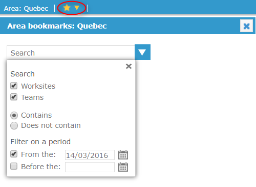
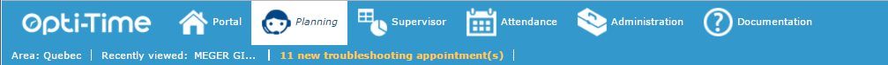
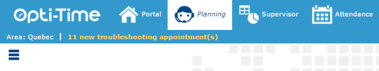
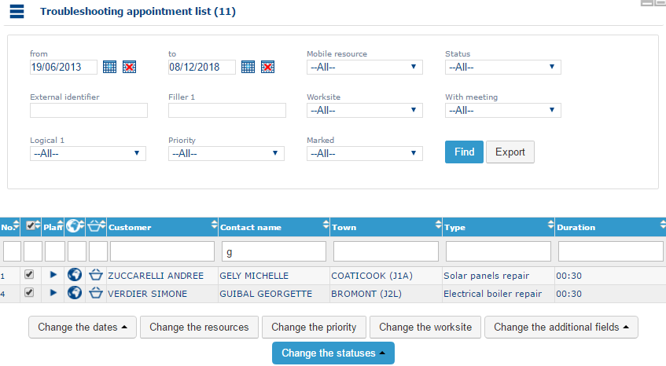
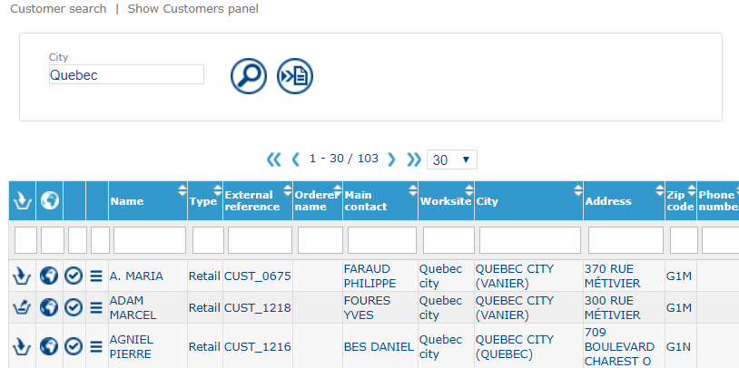

# The Header Bar

## Overview

In addition to the general functions in [The Header Bar](../the-header-bar/guided-help-nfs-reference-guide-1.md), the Planning module offers additional functions that facilitate scheduling. Which functions are available depends on the application configuration.

## Favorites for the area

Click the **star** to activate or deactivate the area favorites defined in the **Favourites Manager** pane. You can filter the selection by **teams** or **worksites**. By default, these selections correspond to those defined in the respective form, but you can modify them here.

Once activated, the selected **resources, teams and worksites** are automatically restricted throughout the module.

## Recent appointments

As you browse the planning, the header bar displays the appointments you viewed recently.

Click a recently viewed appointment to open its form.

## List of urgent appointments

You can configure a predefined search list based on one or more **task types** and specific **appointment characteristics**, such as logical criteria, fulfilment periods and status fields.

Use this function to quickly identify **urgent appointments**, such as breakdown-related appointments.

You can link the predefined search list to a **warning counter** displayed in the upper section of the application interface. The counter increases each time an appointment that meets the defined criteria is created.

To display the list of urgent appointments as a search form (see [Objects in the Planning Module](objectsintheplanningmodule.md)), click the link in the header bar or the link in [The Information Pane](theinformationpane.md).

The buttons available in the list of urgent appointments are described in [Objects in the Planning Module](objectsintheplanningmodule.md).


You can configure this list so that it is displayed in the header bar. See [Customization](../administration/customization.md).


## List of customers on alert

As for urgent appointments, you can define specific criteria for customers and display a corresponding **counter** in the header bar.

The counter is updated automatically whenever a new customer matching the defined criteria is created.

When enabled, the customer counter is displayed in the **header bar**, to the right of the **urgent appointments** counter.

Click the counter to display a search page with the predefined list criteria.

The list of matching customers is displayed in the same way as for a standard customer search (see [Menu](menu.md)).


You can configure this list so that it is displayed in the header bar. See [Customization](../administration/customization.md).

