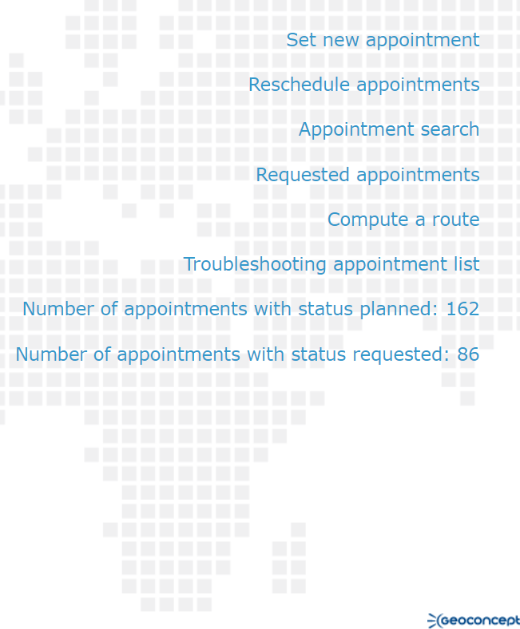
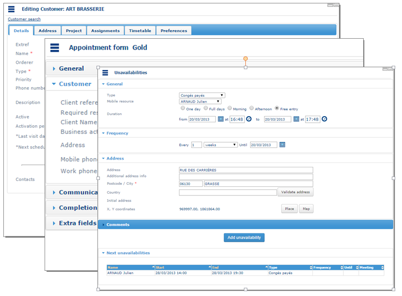
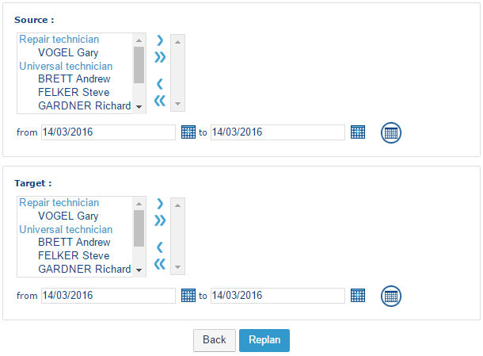
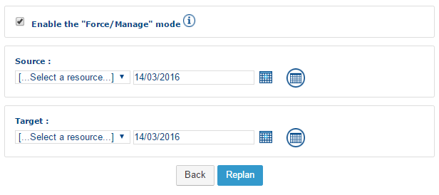
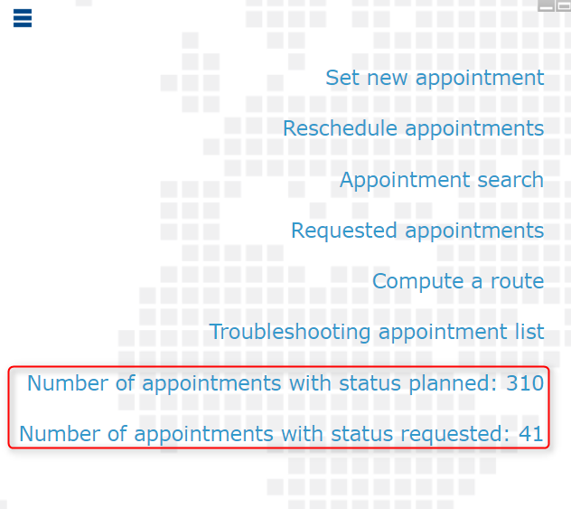

# The Information Pane

## Overview

The information frame is located to the left of the Planning module screen. It contains shortcuts that correspond to the functions of the [Menu](menu.md). Use it to replan several appointments and to display the appointment counters.

This frame also displays the detailed forms for appointments, unavailabilities, customer information, views, search formulas and so on.

## Replan appointments

This function replans appointments that have already been planned, assigning them to other resources or other dates.

1. In the first part of the screen, select the appointments to replan. Select one or several **sources** in the list and enter a time interval in the **from** and **to** date fields.
2. Click the  button to display the agendas concerned in the planning pane.
3. In the second part of the screen, select the destination agendas (**target**) in the same way as for the sources.
4. Click **Replan** to replan the appointments.

Click **Back** to return to the previous screen.

Once planning is complete, the number of appointments replanned is displayed at the end of the page.


The more destination resources you select and the longer the time interval, the greater the chance that an appointment is replanned.


### Force / manage mode

The **Force / Manage** mode allows you to force a replanning operation.

1. Select the corresponding check box to activate the mode.
2. Click **Replan**. The list of constraints that prevent the scheduling is displayed at the bottom of the screen.
3. Click **Force appointment** to force these constraints.

## Appointment counters

The Planning module home page can display a number of appointment counters, by status. These counters depend on a centralized configuration (see [Customization](../administration/customization.md)) that searches the database for appointments that meet certain criteria (notably a time scale).

You can configure up to 7 counters:

* Number of appointments with status **requested**
* Number of appointments with status **suspended**
* Number of appointments with status **planned**
* Number of appointments with status **reserved**
* Number of appointments with status **confirmed**
* Number of appointments with status **fulfilled**
* Number of appointments with status **cancelled**

Click a counter to display the list of appointments concerned as a search form (see [Objects in the Planning Module](objectsintheplanningmodule.md)).

The fields displayed in this list are those of the appointment form (see [Objects in the Planning Module](objectsintheplanningmodule.md)). You can configure them if required.

Click a record in the list to open the appointment form (see [Objects in the Planning Module](objectsintheplanningmodule.md)).

The buttons are described in the chapter on appointment lists (see [Objects in the Planning Module](objectsintheplanningmodule.md)).
