# The Planning

## Overview

The planning pane is located at the bottom right of the Planning screen. Like the other panes, it can be resized as required.

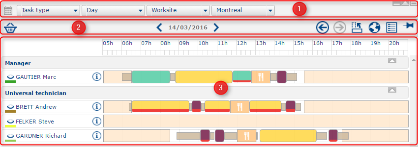

The planning pane is composed of three sections:

1. A selection bar for the different views in the plannings.
2. A navigation bar, made up of navigation and display buttons.
3. The agenda part, which contains appointments, unavailabilities and other objects.

On this pane you can consult, modify and handle the planning of one or several technicians, sales personnel or resources. You can also handle plannings at the level of a worksite (team, area, and so on).

## Hide or display plannings by post occupied

1. Click the  button to hide the plannings and resources that occupy a single post.
2. Click the  button to redisplay any plannings that you hid previously.

## Planning views

You control the view of the planning with three main options:

* the agenda kind;
* the period;
* the hierarchical level.

In each of these drop-down menus, type the first letter of a word to go directly to the word you are looking for.

The 3 display options for the planning

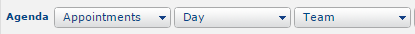

### Agenda kind

Agenda kinds available

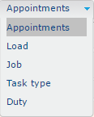

The planning manager can visualize the planning of one or several resources according to several kinds:

* **Appointments** – shows the planned appointments for the given period according to their status (planned, reserved, confirmed or fulfilled).
* **Load** – shows the planning according to the workload for the day (that is, how fully booked the day is).
* **Job** – shows the planning according to the temporary post assigned to a resource on the day, the week or the month.
* **Task type** – shows the planning according to the type of appointment planned or fulfilled.
* **Duty** – shows any on-call duty specified for the given period.

### Period

Available periods

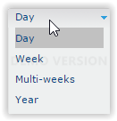

The planning manager can view the planning for one or several resources over four periods. Not all periods are available for every agenda kind:

* **Day** – available for all kinds of planning.
* **Week** – available for all kinds of planning.
* **Multi-week** – available for the **Load** and **Post** kinds of planning.
* **Year** – available for the **Load** kind of planning.


All these availabilities can be modified in the Administration module. For details, see [Company Data](../administration/companydata.md).


### Hierarchical level

You can also display the planning according to several hierarchical levels:

* **Resource** – displays the planning of one resource in particular.
* **Team** – displays the planning of all the resources in one team.
* **Worksite** – displays the planning of all the resources from one worksite.
* **Area** – displays the planning of all the resources in one area.
* **Multi-resources** – displays the planning of several resources, teams, worksites or areas. If no parameters have been set at the outset, NFS directs you to a configuration page.
* **Vehicle** – displays the planning for a vehicle.

Depending on the hierarchical level you select, choose in the drop-down list the resource, team, worksite, area or vehicle whose planning you want to consult.

In **Resource** mode only, the  tool-tip displays information about a route.

### Route info

The information is displayed in the following form:

Abbreviated form for the resource

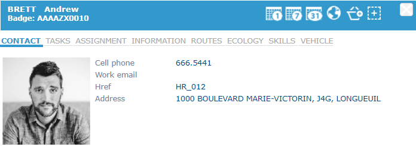

The form comprises the following eight tabs:

* **Contact** – displays the address, the telephone number and the email address of the resource.
* **Tasks** – displays the job held, the level of experience and the appointment types authorized for the resource.
* **Assignment** – displays the team, the main worksite, the secondary worksite and the intervention sector of the resource.
* **Infos** – displays additional information about the resource.
* **Routes** – displays the travel times and kilometers traveled by the resource. In a daily planning, the time and kilometers shown concern the selected day. In a weekly planning, they are the total time and distance traveled for the week. The same applies to a monthly planning.
* **Ecology** – displays the total CO2 emissions attributable to the resource.
* **Skills** – displays the skills of the resource.
* **Vehicle** – displays the [default vehicle used](../administration/companydata.md), and the vehicle and equipment [assigned](../administration/mobility.md) to the resource, as well as the period of assignment. For details, see [Company Data](../administration/companydata.md) and [Mobility](../administration/mobility.md).

The form also contains the following buttons:

*  – displays the daily planning for the resource.
*  – displays the weekly planning for the resource.
*  – displays the monthly planning for the resource.
*  – displays the route.
*  – puts all the appointments for the route in the panel.
*  – selects all the appointments in the route. For details, see [Menu](menu.md).

## Navigation bar

In addition to the planning visualization parameters, other tools let you navigate in the planning to consult it.

Bar of viewing functions in the planning

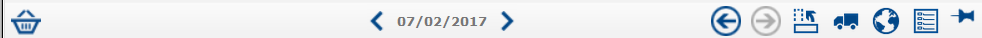

The navigation bar contains the following buttons, from left to right:

* The panel .
* The buttons to change the date of the agenda, composed of two arrows and a date:
  * The arrows to return to the previous  or next  agenda.
* The switch agenda  button.
* The button to display the position of the resource on the map .
* The button to display the routes on the map .
* The button to display the legend .
* The map pin .

### The panel

When appointments are present in the panel, a symbol on the panel icon  indicates how many.

To view the appointments stored in the panel, click the panel icon. The appointments are stored by resource and with the relevant identifiers.

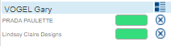

To replan an appointment from the panel into a planning, drag and drop it onto a timeslot:

* If the timeslot is free, NFS plans the appointment automatically.
* If NFS encounters a clash (an unavailability, an appointment already planned or a constraint that is not respected), a message summarizes the conflict. You can then choose whether to force the placement of the appointment. The appointments in conflict are then replanned.

You have two other options:

1. Move the orange frame in the panel onto the planning of a resource. NFS tries to replan all appointments in this planning and displays the number of replanned appointments.
2. Move an appointment from the panel onto the name of a resource. NFS chooses the best timeslot in the resource's day in which to position the appointment.

### Navigate from one date to another

* To consult the planning for earlier or later periods, click the  or  button.
* To select a date directly in the agenda, click the date.


In multi-day views, click a day of the week to display that day's agenda. This lets you move from a week view to a day view of the agenda.


### Previous or next agenda

* Click the  button to quickly return to an agenda you viewed recently. Click the  button to move forward again to the next agenda.
* These buttons navigate through the plannings you viewed previously, in all their forms. For example, if you moved from a resource view to a worksite view, click  to return to the worksite view.


These buttons do not cancel an operation performed earlier. They are for consultation only.


### Switch the agenda

By default, the agenda is displayed horizontally, with the names of the resources in rows and the time, days, weeks or months in columns.

1.  Click the  button. The agenda switches to vertical viewing mode.

    Example of a vertical agenda

    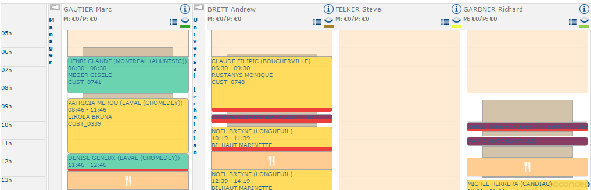
2. To return to the default agenda display, click the  button.

### Display the location of the resource on the map

* This button displays the location of the resource on the map.
* In addition to the position of the resource, NFS shows whether this position corresponds to the planned itinerary.

### Display routes on the map

This button displays the routes in the agenda on the map.


This button is only available in day or week views.


Visualizing a route on the map

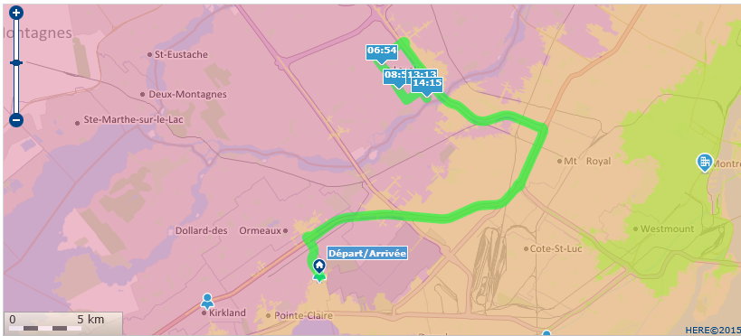

* All resources scheduled for the viewed period are indicated by a tool-tip that gives the time of the resource.
* When you display the routes of several resources, each route is shown in the color of the corresponding resource.

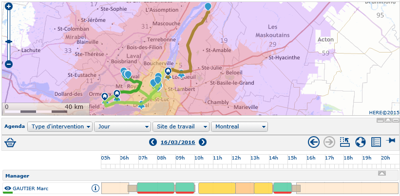


In multi-resource mode, the eye just to the left of the resource name in the planning lets you display or hide the route.


### Display the legend

Legend

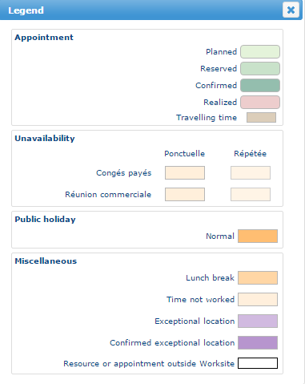

* The legend shows the color of the various items in the planning, by object type. For details, see [Objects in the Planning Module](objectsintheplanningmodule.md).
* The colors of the objects displayed in the planning are configurable. For details, see [Customization](../administration/customization.md).


The legend adapts to fit the displayed view.


### Map pin

* When you work in the information pane (for example, to search for an appointment), the planning is updated automatically to display the agenda that matches the search. For details, see [The Information Pane](theinformationpane.md).
* The map pin button fixes the planning view and prevents this automatic updating.


This function cannot block all manipulations in the planning view (display by appointment kind, periods, and so on).


## The agenda

The agenda part is made up of one or several days of one or several resources. The items for the day are displayed in graphical form, either horizontally or vertically. A table at the bottom of the page displays the detail of these items.

The colors of the items in the planning are described in the legend. For details, see [Display the legend](theplanning.md#display-the-legend).


The priority levels for appointments are shown by a red line. The thickness of the line reflects the priority level of the appointment in the planning.


The appearance of the agenda varies depending on the selected view.

Day agenda for the worksite

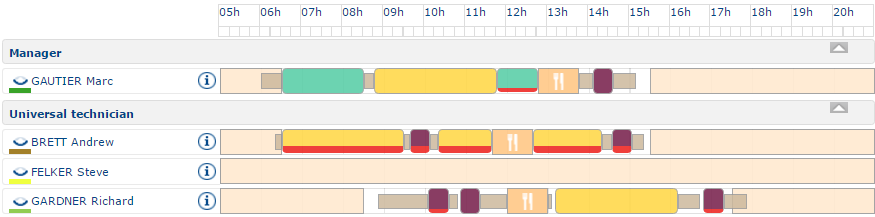

Day agenda for the resource

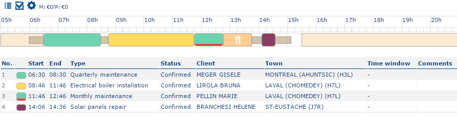

In this view, below the graphical representation of the agenda, a list gives the details of all the items in the planning in chronological order. It shows the start and end time, the appointment type, the status, and the names of both the appointment and the town in which it takes place.

Monthly agenda for the resource in workload view

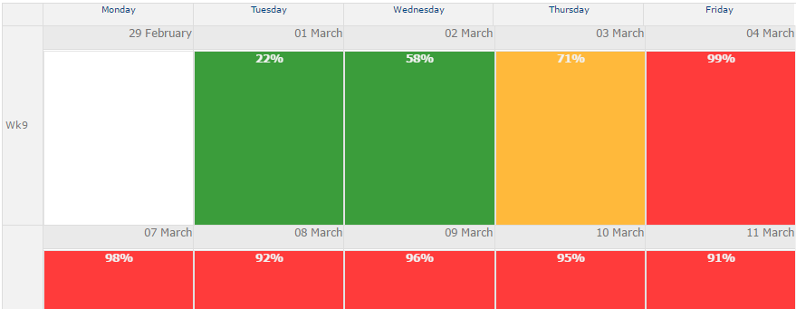

According to your [user rights](../administration/userhandling.md), the agenda gives access to the following functions. For details on rights, see [User Handling](../administration/userhandling.md).

* Reoptimize a day or week.
* Move or extend items (appointments, unavailabilities or exceptional locations).
* Manage appointments.
* Manage unavailabilities.
* Manage non-worked hours for the resource.
* Manage exceptional locations.
* Manage locked agendas.
* Manage temporary work posts.
* Fill free timeslots in the agenda.
* Display information about journey times.
* Display information about the lunch break.
* Edit the roadbook. For details, see [Menu](menu.md).
* Display information about the resource: click the  button opposite the name of the resource.

### Reoptimize the day

The  button runs a reoptimization of the day for a technician directly from their planning.

1. Click the  button.
2. In the window that opens, define the time from which the reoptimization of the day starts.
3. Define whether NFS can insert appointments to be planned, or only keeps those already planned on that day.

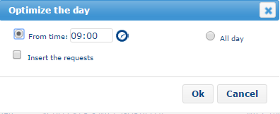


The option to reoptimize is also available in the weekly agenda. In that case, all the appointments for the week are reoptimized.


### Move or extend objects

You can move or extend all objects in the planning: [appointments](objectsintheplanningmodule.md), [unavailabilities](objectsintheplanningmodule.md), non-worked hours, [nights away](objectsintheplanningmodule.md) and [agenda markers](objectsintheplanningmodule.md). For details, see [Objects in the Planning Module](objectsintheplanningmodule.md).

#### Move an object in the planning

To move an object, drag and drop it to the position you want in the planning.


Not all drag-and-drop operations are authorized. For example, dropping an appointment on a resource who does not have the skills does not work the first time. A window opens and asks whether you want to force the insertion of the appointment in the planning.


#### Extend an object in the planning

1.  Move the mouse cursor to the extremity of the object.

    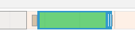
2.  Click and stretch the object: forward to shorten it, or backward to make it larger.

    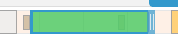
3. Confirm the extension in the window that displays.


In some cases, you cannot extend the object. For example, if the planning is full and extending an appointment interferes with the feasibility of the journey to or from the appointment, or to the next appointment, you cannot extend it. NFS then displays the message "no solution found".



In earlier versions of NFS, you had to select the corresponding option in the appointment tool-tip to extend or move an object.


### Manage appointments in the agenda

Move the mouse cursor over an appointment to display the appointment tool-tip.

Appointment information popup

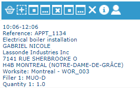

The tool-tip contains some information from the [appointment](objectsintheplanningmodule.md), such as the customer name and the appointment address or site.

The action buttons of the tool-tip apply the following operations to the appointment. For the status names, see [The different statuses for appointments in NFS](../introduction/thedifferentstatusesforappointmentsinnfs.md).

*  – puts the appointment in the panel.
*  – adds the appointment to the list of selected appointments.
*  **Reserve** / **Unconfirm** – changes the appointment [status](../introduction/thedifferentstatusesforappointmentsinnfs.md) to **Reserved**, or back to the previous status.
*  **Unplan** / **Suspend** – changes the appointment [status](../introduction/thedifferentstatusesforappointmentsinnfs.md) back to the previous status, or to **Suspended**.
*  **Reactivate** – changes the appointment [status](../introduction/thedifferentstatusesforappointmentsinnfs.md) to **Requested**.
*  **Delete** – changes the appointment [status](../introduction/thedifferentstatusesforappointmentsinnfs.md) to **Abandonned**.
*  – cancels the appointment.
*  – displays the [appointment form](objectsintheplanningmodule.md).
*  – displays the [customer form](objectsintheplanningmodule.md).


When you click an appointment in the planning, the [appointment form](objectsintheplanningmodule.md) opens directly and the appointment is displayed in the [map](map.md). For details, see [Map](map.md).


### Manage unavailabilities in the agenda

Move the mouse cursor over an unavailability in the agenda to display its infobox.

Infobox for an unavailability

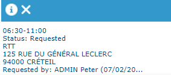

The infobox displays information about the unavailability. It contains the following buttons:

*  – displays the [abbreviated unavailability form](objectsintheplanningmodule.md).
*  – deletes the unavailability. For a regular unavailability, a message lets you choose between deleting all repetitions or only the selected unavailabilities.


When you click an unavailability in the planning, the [abbreviated unavailability form](objectsintheplanningmodule.md) opens directly and the unavailability is displayed in the [map](map.md).


### Manage non-worked hours in the agenda

Move the mouse cursor over the non-worked hours of a resource (start or end of the day) to display an infobox that shows the manipulations that are possible.

Infobox for a series of non-worked hours

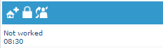

*  – returns you to the page for managing nights away.
*  /  – locks or unlocks the day.
*  – adds an [unavailability](../administration/companydata.md) in the agenda. For details, see [Company Data](../administration/companydata.md).

### Manage exceptional locations in the agenda

Move the mouse cursor over an [exceptional location](objectsintheplanningmodule.md) to display its infobox. The infobox shows some of the information items from the [exceptional location form](objectsintheplanningmodule.md).

*  – displays the [exceptional location form](objectsintheplanningmodule.md).
*  – deletes the exceptional location.

### Manage locked agendas

Click the lock of a locked day 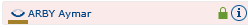 to display the [locked day form](objectsintheplanningmodule.md).

### Handle temporary posts in the agenda

In posts view, move the mouse cursor over a non-worked timeslot to display the posts infobox.

*  – creates a [temporary post](menu.md). For details, see [Menu](menu.md).

On an existing post, the infobox contains the following buttons:

*  – displays the [temporary post form](objectsintheplanningmodule.md).
*  – deletes the temporary post.

### Fill an empty agenda

Move the mouse cursor over the empty planning of a resource to display an infobox with several possible manipulations.

Infobox for an empty planning

1. **Filling the empty planning** – Click the fill button in the infobox. By default, NFS searches for all appointments with the status **Requested** or **Suspended** that it can add to the planning. For the statuses, see [The different statuses for appointments in NFS](../introduction/thedifferentstatusesforappointmentsinnfs.md).
2. **Adding an appointment** – Click the add appointment button to plan an appointment that does not yet exist among the appointments to be planned. The customer [information form](menu.md) displays. For details, see [Menu](menu.md).
3. **Making an appointment for an existing customer** – Click the  button to schedule an appointment for an existing customer. The customer [search function](menu.md) then displays.
4. **Adding an unavailability** – Click the add unavailability button to display the [unavailability form](objectsintheplanningmodule.md).
5. **Creating an express unavailability** – Click the  button in the infobox. This option is usable only if an [express unavailability](../administration/companydata.md) has been configured beforehand for the resource. NFS then places the express unavailability automatically in the planning of the resource.
6. **Adding a locked day** – Click the  /  button to lock or unlock the day.
7. **Adding a marker** – Click the marker button to [add a marker](objectsintheplanningmodule.md).

### Journey time infobox

Move the mouse cursor over the journey time between two appointments, for example, to display an infobox with the number of kilometers and the journey time.

Journeys that are not connected with the appointment (for example, the return journey between a night away and the usual return address) can also be displayed in the agenda if the application configuration allows it: **Display** tab > **Calendar** > `planning.content` > `completeWithMoves`. For details, see [Customization](../administration/customization.md). To force the splitting of the appointment, limit the duration of these journeys with the `moveMaxDisplayedDuration` parameter.

### Lunch break infobox

Move the mouse cursor over the lunch break of a resource to display the corresponding information popup. It shows the duration of the lunch break.

The  /  button locks or unlocks the day.
