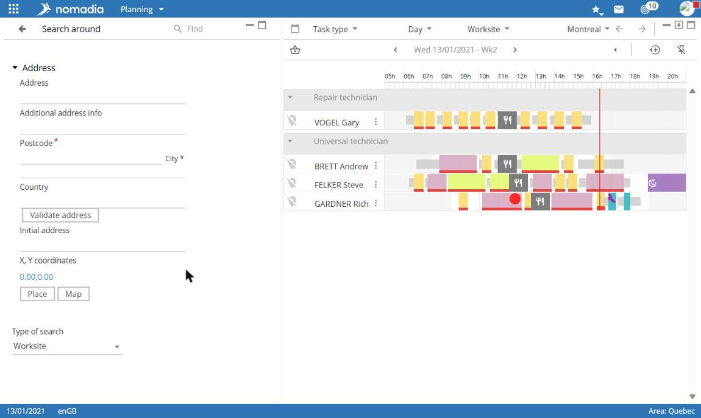
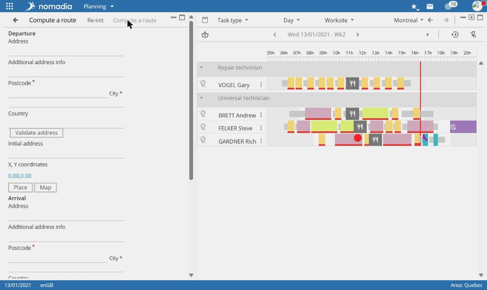
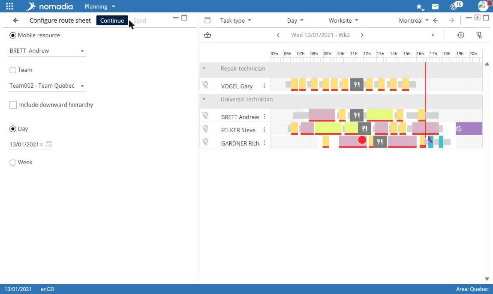

# Use the location and export tools

The **Location** and **Exports** sections of the Planning module menu group mapping tools and ready-to-use exports.

## Access the feature

**Navigation:** `Planning > Location menu` or `Planning > Exports menu`

The entries displayed depend on your rights and on your environment's configuration.

## Search around an address

This function searches for items located near an address: work sites, vehicles, customers, hotels, or appointments.

1. Open `Planning > Location menu > Search around`.
2. Enter the address, then select **Validate address**. For more information, see [Geocode an address](../introduction/geocode-an-address.md).
3. Choose the **Type of search**.
4. For an appointment search, specify the status, the period (**From**, **To**), and the **Intervention type** if needed.
5. Start the search.

## Compute a route

1. Open `Planning > Location menu > Compute a route`.
2. Enter and validate the **Departure** address, then the **Arrival** address.
3. Enter the **Date**.
4. Select **Compute a route**.

Select **Re-init** to clear the form.

## Get the latitude and longitude of an address

1. Open `Planning > Location menu > Convert coordinates into Lat/Lon`.
2. Enter and validate the address.
3. Select **Convert**. The latitude and longitude are displayed.

## Track geolocated vehicles

The `Planning > Location menu > Vehicles tracking` entry displays the positions and states of geolocated vehicles.

* Filter the list by work site.
* Select the automatic refresh option to update the positions regularly.

## Run a predefined export

The **List predefined exports** entry appears only if your administrator has configured at least one export.

1. Open `Planning > Exports menu > List predefined exports`.
2. Choose the export.
3. Filter the data: region, work site, resources, team, and intervention type.
4. Run the export.

## Edit a route sheet

1. Open `Planning > Exports menu > Route sheet`.
2. In **Configure route sheet**, choose the **Mobile resource** or the **Team**. Select **Include downward hierarchy** to include the attached teams.
3. Choose the period: **Day** or **Week**.
4. Select **Continue** to display the route sheet, or **Send** to send it.

The route sheet is also available from the **⋮** menu of a field worker in the schedule.

<!-- REVIEW: the following labels are translated from the French topic and were not verified in the application: the other Type of search values (vehicles, GPS vehicles, customer, hotel, appointment), the Convert button and the latitude and longitude field, the automatic refresh option, and the predefined export fields. The address validation could not be run in the test environment. -->
