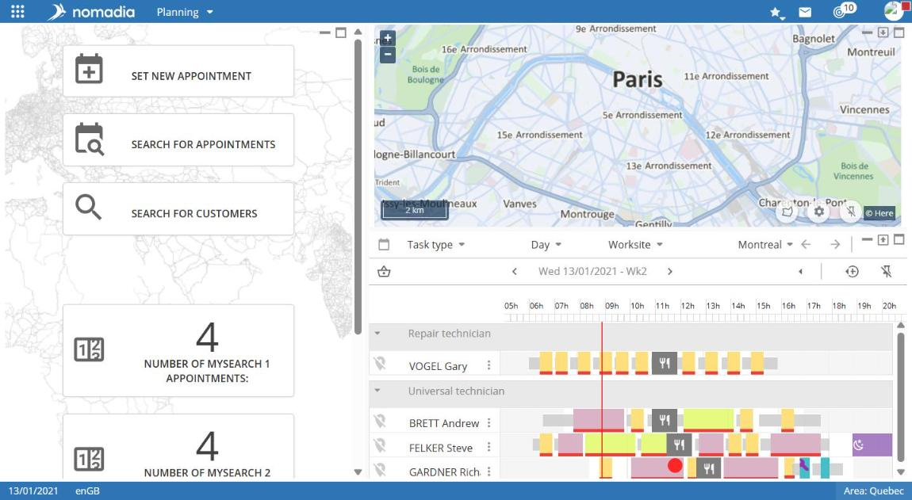

# Use the map

The map, at the top right of the Planning module, displays the appointments, work sites, and positions that are useful for planning. It takes your scope into account: region and rights.

## Access the feature

**Navigation:** `Planning`, the panel at the top right of the screen.

## Move around the map

* Drag the map with the mouse to move around.
* Use the mouse wheel or the **Zoom in** and **Zoom out** buttons to zoom in and out.

## Choose what the map displays

1. Select the **Map configuration** button.
2. Select the items to display:
   * **Show appointments**: you can filter by **Intervention type** and by period (**From**, **To**);
   * **Show sectors**: sectors for which towns are entered in their record are displayed on the map.

## Act on an appointment from the map

Select an appointment on the map to display its tooltip. Depending on your rights, the tooltip offers:

| Action               | Purpose                                                                       |
| -------------------- | ----------------------------------------------------------------------------- |
| **Display**          | Opens the appointment record.                                                 |
| **Add to basket**    | Adds the appointment to the planning appointment basket.                      |
| **Select**           | Adds the appointment to the list of selected appointments.                    |
| **Search around**    | Searches for objects near the appointment.                                    |

For more information about nearby searches, see [Use the location and export tools](use-location-and-export-tools.md).

<!-- REVIEW: the labels Map configuration, Show appointments, Show sectors, Zoom in, Zoom out, Intervention type, From, To, and the tooltip actions Display and Select are translated from the French topic and were not verified in the application, because the map did not load in the test environment. Add a screenshot of the map configuration and of an appointment tooltip. -->
