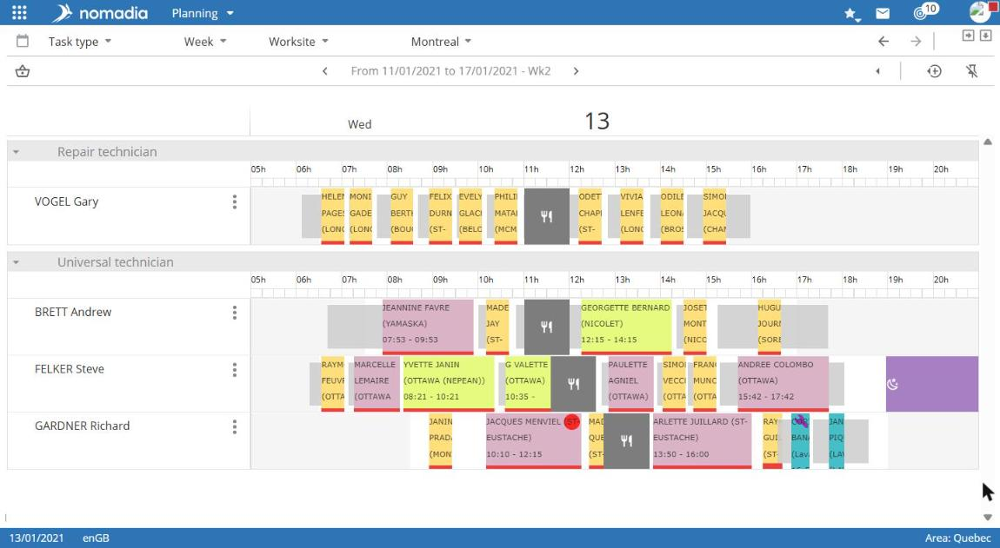
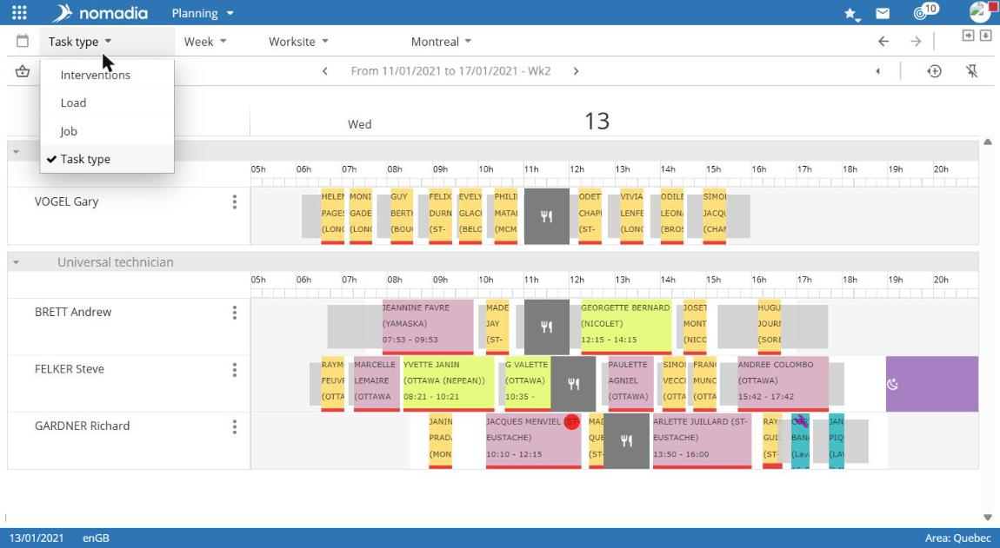
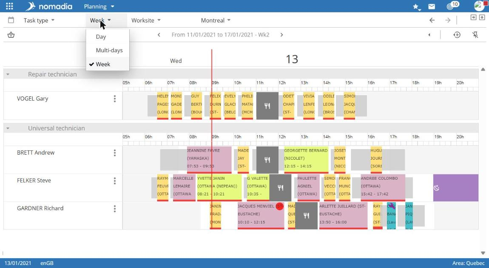
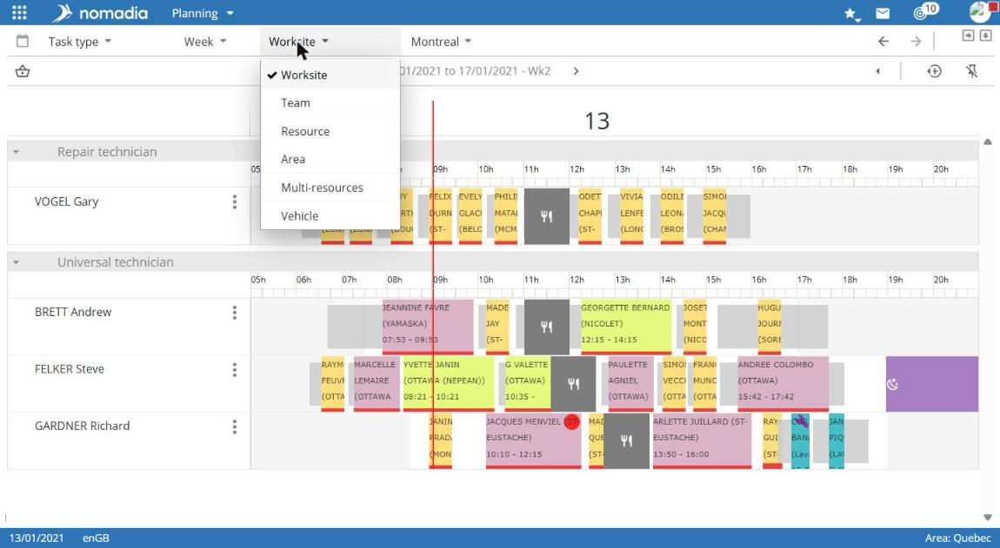
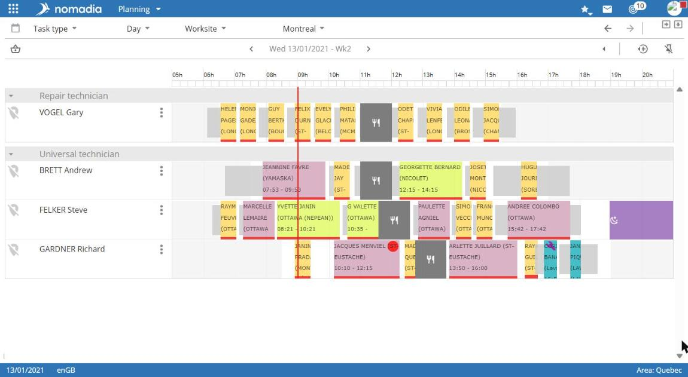
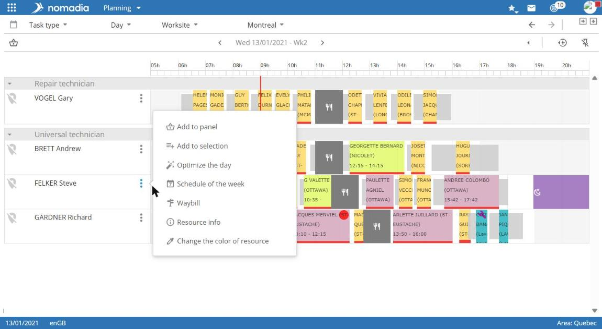
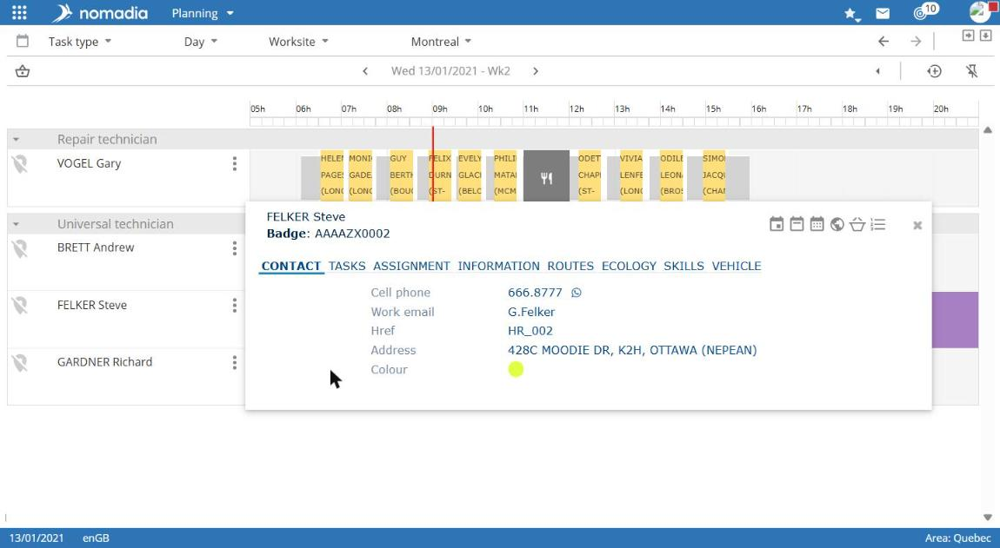

# View the schedule

For each field worker, the schedule displays appointments, unavailabilities, and breaks for the selected period.

## Access the schedule

**Navigation:** `Planning`, the panel at the bottom right of the screen.

To display the schedule across the full screen width, use the expand icon at the top right of the panel.

## Choose the display

The schedule's top bar contains three lists.

| List          | Values                                                                                |
| ------------- | ------------------------------------------------------------------------------------- |
| Calendar type | **Interventions**, **Workload**, **Position**, **Intervention type**                  |
| Period        | **Day**, **Week**                                                                     |
| Level         | **Worksite**, **Sector**, **Team**, **Field worker**, **Region**, **Multi-resources** |

To the right of the lists, select the item to display, such as the team or field worker.

## Change the period

* Use the arrows on either side of the displayed period, such as `From 20/04/2026 to 26/04/2026 - W17`, to move to the previous or next period.
* Use the **Previous calendar** and **Next calendar** arrows at the top right to navigate between displayed calendars.

## Read the schedule in Day view

In **Day** view, a time scale appears at the top of the schedule. Each row represents a field worker.

* Appointments display their start and end times.
* Unavailabilities display their type, such as **CALLBACK** or **LEAVE**.
* The cutlery icon indicates the lunch break.

## Use a field worker's menu

Select the **⋮** icon to the right of a field worker's name. The menu offers:

* **Add to basket**;
* **Add to selection**;
* **Reoptimize the week**;
* **Weekly schedule**;
* **Route sheet**;
* **Display locked days**;
* **Resource mini-card**.

## View a field worker's mini-card

1. Open the field worker's **⋮** menu.
2. Select **Resource mini-card**.

The mini-card displays the field worker's name and employee number. It includes the **CONTACT**, **TASKS**, **EQUIPMENT**, **ASSIGNMENT**, **INFO**, **HOURS**, **ROUTES**, **ECOLOGY**, **SKILLS**, and **VEHICLE** tabs. The **CONTACT** tab displays the mobile number, work email, address, and field-worker color.

Displayed tabs depend on the application configuration. To display the **QUOTA** tab and additional indicators, see [Display route indicators in the resource mini-card](resource-monitoring/display-route-indicators-in-the-resource-mini-card.md).

## Points to note

* The pin icon at the top right of the schedule lets you **Enable/disable schedule freezing**.
* The basket icon at the top left of the schedule opens the **Appointment basket**.
