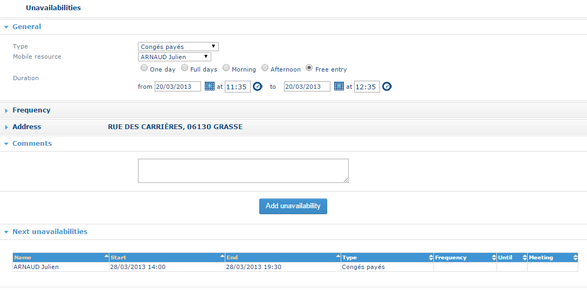

# Adding an unavailability

## Overview

The **Handling unavailabilities** button on the [Unavailabilities](unavailabilities.md) page opens a new window that you use to add unavailabilities.

The bottom part of the window displays the table of the next unavailabilities. Click a column heading to sort the unavailabilities by that column. Click the same heading again to reverse the sort order.

To add an unavailability, specify:

* **Resource**
* **Unavailability type**
* **Start and end dates**
* **Start and end times**
* **Periodicity**, if the unavailability is regular
* **Location**
* **Comments**, if required

## Add an unavailability

### Select the unavailability type and resource

1. In the **Unavailability Type** list, select the type of unavailability. **Non-worked day** is selected by default.
2. If you select **Meeting** or **Training**, the unavailability is a multi-resource unavailability. See [Adding a multi-resource unavailability](addinganmultiresourceunavailability.md).
3. In the **Resource** list, select the resource concerned by the unavailability.

### Specify the date and time

4. Enter the start and end dates in the corresponding fields (for example, `02/03/2013`), or select them using the calendar.
5. Enter the start and end times in the corresponding fields (for example, `10:30`).

For a regular unavailability, specify the following additional information:

* **Periodicity** – the interval at which the unavailability is repeated, expressed in days, weeks, or months.
* **Repeat-until date** – the date on which the recurrence ends. If you do not specify a date, the unavailability is repeated indefinitely.

### Specify the location

6. Enter the address where the unavailability occurs.

If a default location is defined for the selected unavailability type (see [Company Data](../administration/companydata.md)), it is suggested as the location of the unavailability. Otherwise, enter the street, postal code, and town, then click **Validate the address**. The application suggests a list of the addresses that most closely match the address you entered. Select the appropriate address.

### Add comments

7. In the **Comments** field, enter any additional information. The comments are saved as a note associated with the unavailability.
8. Click **Add Unavailability** to validate the information and add the unavailability to those already present.

The application checks that the new unavailability does not conflict with existing unavailabilities. The window closes and the list of unavailabilities is updated.
