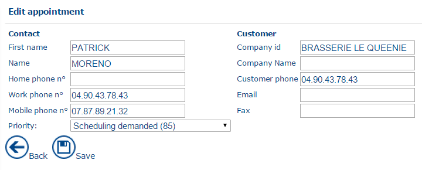

# Appointment Form

## Overview

Click an appointment in the daily planning to open the corresponding **Appointment** form.

## View and edit an appointment

The **Appointment** form provides access to the information and actions related to the appointment:

1. **Appointment details** – Displays the details of the appointment.
2. **Access map** – Displays a map to help the mobile resource locate the appointment.
3. **Notes** – Lets you enter comments or additional information related to the appointment.
4. **Back** – Returns to the previously displayed screen.
5. **Edit** – Lets you enter or modify the contact information, including:
   * First name and surname
   * Home, work and mobile telephone numbers
   * Title
   * Company name
   * Customer telephone number
   * Fax number
   * Email address

## Fields and options

* **Priority** – Use the drop-down list to select the priority level of the appointment. A higher value indicates a higher priority.
* **Back** – Returns to the previous screen without saving the changes.
* **Save** – Saves the changes made to the appointment form.
* **Visit report** – Displays the edit page for the visit report (see [Visit Reports](visitreports.md)). The button is visible only if the appointment has been fulfilled.
* **Suspend** – See [Objects in the Planning Module](../planning/objectsintheplanningmodule.md).
* **Reactivate** – See [Objects in the Planning Module](../planning/objectsintheplanningmodule.md).
* **Delete** – See [Objects in the Planning Module](../planning/objectsintheplanningmodule.md).
