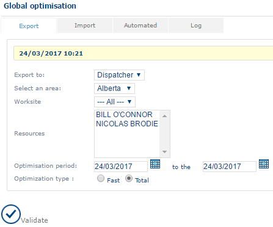

# Global Optimization

## Overview

This function gives access to the optimization management commands (see the Administration module), including a command for running an optimization on individual files.

## Export tab

The **Export** tab runs an optimization and retrieves the result in a file.


This function does not modify the plannings.


To run an optimization:

1. Select an **area**.
2. Specify the **period**.
3. Choose the **optimization type**:
   * **Fast** – Optimizes only the selected appointments.
   * **Total** – Re-optimizes all planned appointments, except confirmed appointments, and inserts new requests.

The optimization file is created at the specified location.

## Import tab

The **Import** tab imports a file for optimization.


The result of this optimization is imported into the plannings.


1. Select a file to import.
2. Click **Update**.

## Automatic tab

See [Optimization](../administration/optimisation.md) in the Administration module.

## Journal tab

See [Optimization](../administration/optimisation.md) in the Administration module.
