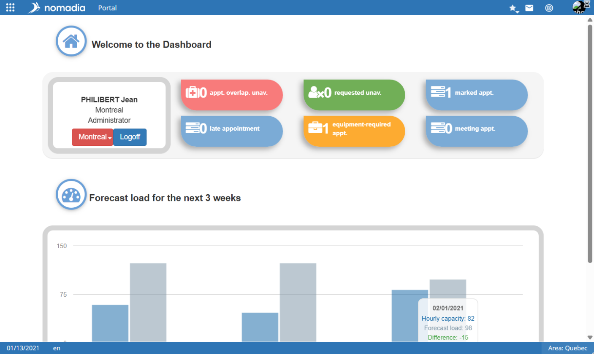

# Home Page

## Overview

To open the module home page directly, click **Portal** in the menu.

The **Portal** home page is divided into two sections: the main menu and the central section.

## Main menu

The main menu is in the **top-left corner** of the screen. The functions available in the menu depend on your access rights.

* **Today** – Displays the resource's daily planning and the tasks to be completed. For team leaders, this section also displays team alerts. Team leaders can use the **Email alert** button to send an email to the relevant team members.
* [Week](week.md)
* [Month](month.md)
* [Team Schedule](teamschedule.md)
* [Area Schedule](areaschedule.md)
* [Worksite Schedule](worksiteschedule.md)
* [Multi-Resource Schedule](multiresourceschedule.md)
* [Unavailabilities](unavailabilities.md)
* [Visit Reports](visitreports.md)
* Route sheet (see [Menu](../planning/menu.md))
* [Global Optimization](globaloptimization.md)
* [Legend](legend.md)
* [NFS Mobile Application](nfsmobileapplication.md)

## Central section

The central section displays the information available in the Portal.
