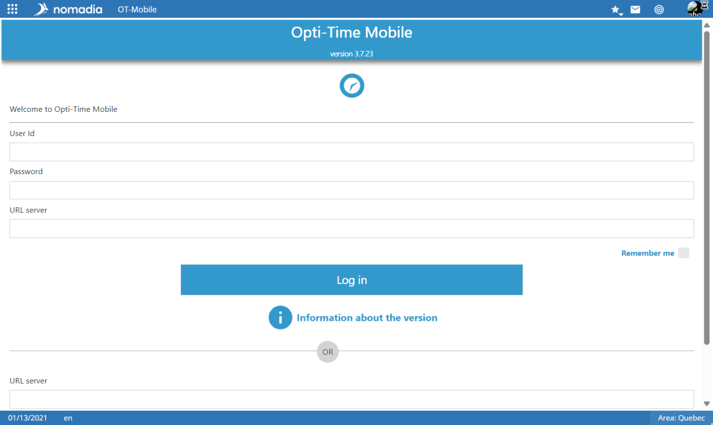
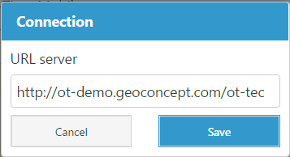

# NFS Mobile Application

## Overview

This page lets you simulate the NFS Mobile application.

## Prerequisites


To use this function, the **NFS Mobile** web application must have been installed on the server beforehand.


## Configure the display

Use the following options to configure how the application is displayed:

* **Device** – Select the device format from the drop-down list. Available options include **iPhone 5**, **iPad Mini**, **iPad**, **Smartphone 5"** and **Phablet 5.5"**.
* **Resolution** – Select this check box to display the application using the resolution of the selected device, without the device frame.
* **Landscape** – Select this check box to switch between landscape (horizontal) and portrait (vertical) orientation.

## Connect to the application

1. Enter the **login** and **password** of the resource in **NFS Mobile**.
2. Enter the URL of the NFS web application. For example: `http://test-otgs/otgs`
3. Click **Connection**.

The application opens in the configured display format.

