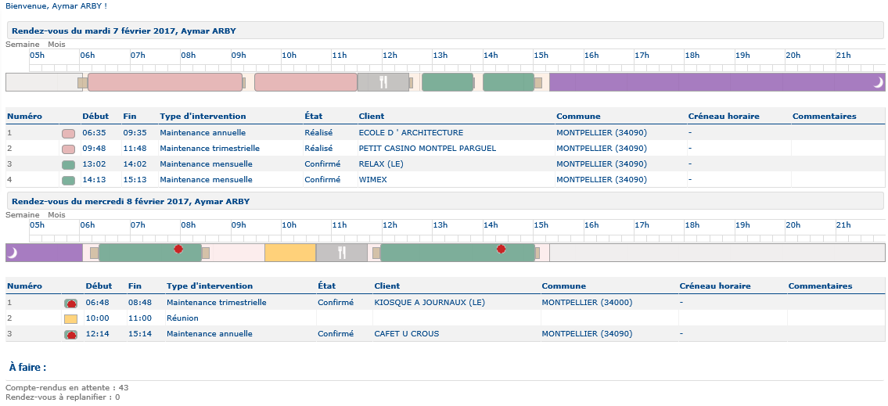
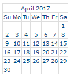

# Planning

## Overview

The central section automatically displays the plannings for **Today** and **Tomorrow**. It contains the same items as the planning in the Planning module (see [The Planning](../planning/theplanning.md)).


Click the **Legend** button in the main menu to display the color key for time windows (see [Legend](legend.md)).


## View the planning for another day

1. Click the **date selector** in the lower-left corner of the screen.
2. Select a date from the **current month** or from the **following two months**.

   The planning for the selected day is displayed.

   

To select an earlier or later date from the calendar, click **Another day**.

After you select the date, the corresponding planning is displayed. You can then view or edit the appointments scheduled for that day.

* Click the week link to display the [Week](week.md) planning.
* Click the month link to display the [Month](month.md) planning.
