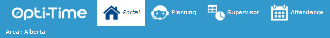

# Portal

## Overview

The Portal is a simplified NFS module designed for mobile staff. It provides access to the essential features they need to manage their appointments and daily activities.

With the Portal, mobile staff can:

* View their appointment schedules and record relevant information in their planning.
* Record visit reports for completed or uncompleted appointments.
* Reschedule appointments that have been placed on hold.
* Record their periods of unavailability.
* Download or view their roadbook.

The Portal also provides team leaders with a monitoring tool. They can view each team member's planning, monitor appointments and send emails when issues arise, such as missed or overlooked appointments.

## Access the Portal

Click **Portal** at the top left of the header bar (see [The Header Bar](../the-header-bar/guided-help-nfs-reference-guide-1.md)).

