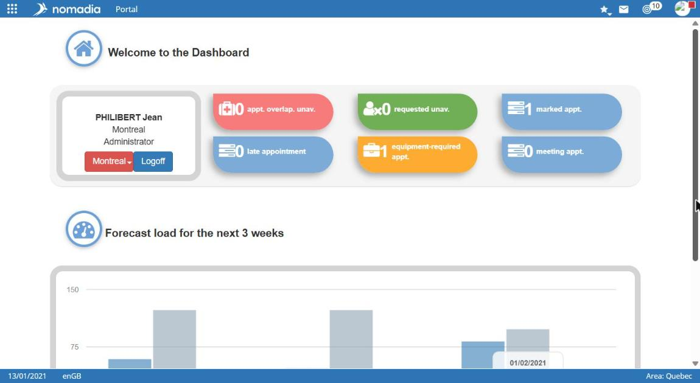
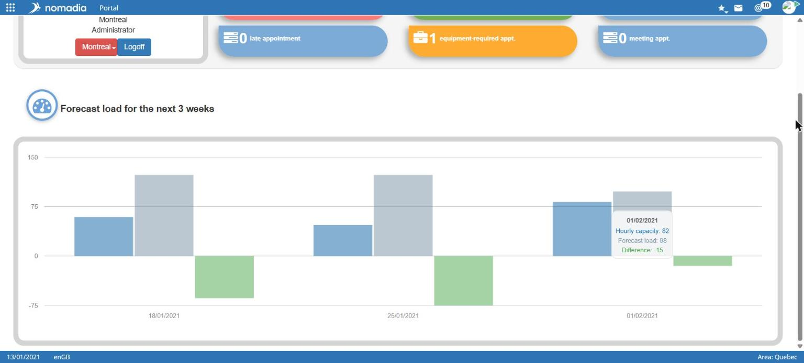

# Portal

The Portal displays a dashboard summarizing field-worker attendance, daily activity, and workload for the coming weeks.

## Access the Portal

**Navigation:** `Application launcher > Portal`

## Read the dashboard

The **Welcome to the dashboard** page contains several areas.

### User card

The card displays your name, site, and username. It contains:

* a site selection button offering **All** or your site;
* the **Sign out** button.

### Alert indicators

Three indicators display these counts:

* **immediate unavailability**;
* **overdue appointment**;
* **urgent appointment**.

### Daily attendance and activity

* The **Daily attendance** tile displays the attendance rate and the number of **Present**, **Partially absent**, and **Absent** workers.
* The **Daily activity** tiles display the number of **Scheduled appointments** and **Completed appointments**, first for all activity, then by intervention type or group.

### Forecast workload

The **Forecast workload for the next 3 weeks** area displays a weekly bar chart. Hover over a week to view a tooltip with **Hourly capacity**, **Forecast workload**, and **Delta**.

