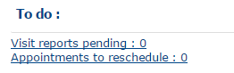
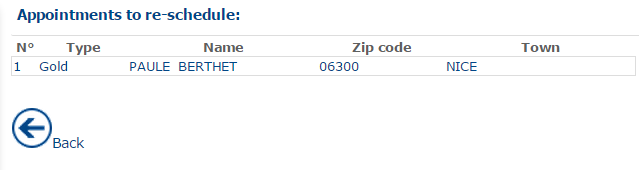
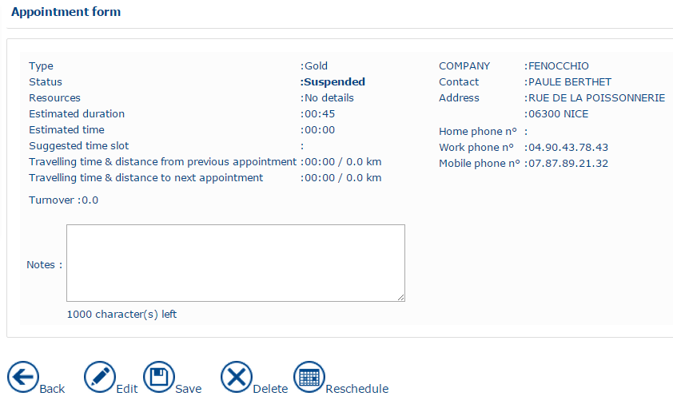
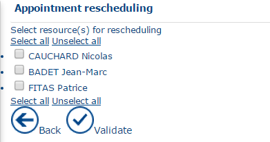
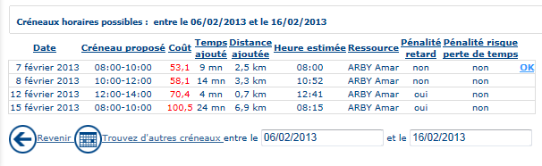
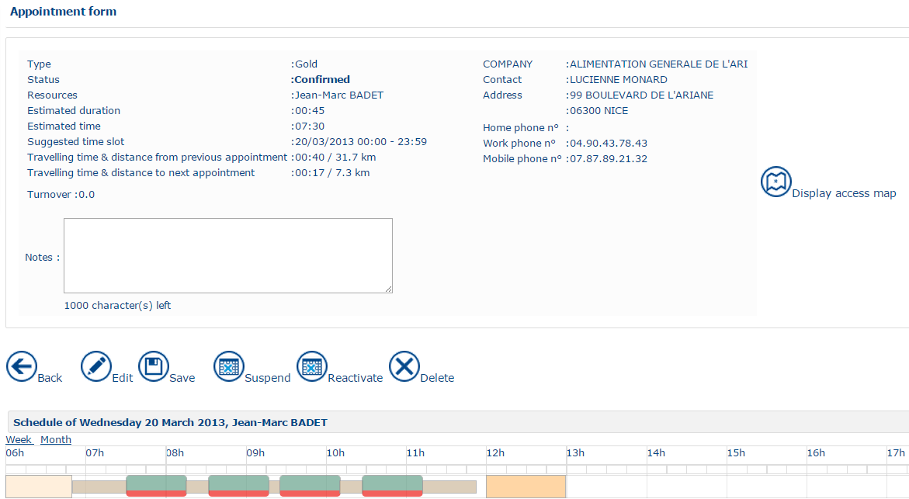

# Tasks to Be Performed

## Overview

The lower part of the home page lists the tasks to be performed. There are two types of task:

* Visit reports pending
* Appointments to reschedule

## Visit reports pending

This list shows the queued visit reports (see [Visit Reports](visitreports.md)).

## Appointments to reschedule

The list of appointments to reschedule is similar to the list of pending visit reports (see [Visit Reports](visitreports.md)).


Only appointments that have been suspended beforehand appear in this list.


* Click the **sequence number** to open the **Appointment** form and enter the required appointment information.
* Click **Reschedule** to search for a new time window that meets all the constraints associated with the appointment.

A page is displayed that prompts you to select the resource to assign to the appointment in the planning.


At this stage, NFS has filtered the competent resources and displays a list of resources suggested as suitable for the job.


* **Back** returns to the list of appointments to reschedule.
* **Validate** opens the list of suggestions made by the real-time optimization engine (RTO). To select the suggestion that best matches the need, click the **OK** button to the right of the table.

<!-- REVIEW: the source text is truncated ("suggestions made by the [OTR."); "OTR" is assumed to mean the real-time optimization engine -->

The immediate effect of validation is to place the appointment in the planning of the chosen resource.

