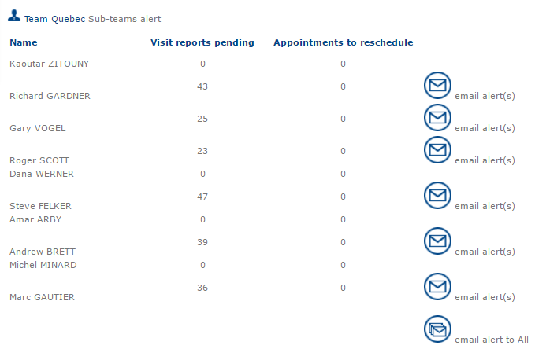
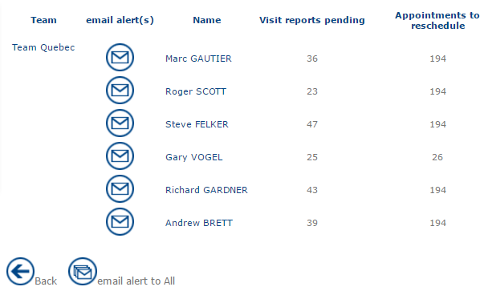

# Team Alerts

## Overview

This section is primarily intended for **team leaders**. It lists the resources assigned to their team and to subordinate teams, which are referred to as **sister teams**.

For each team, the section displays the number of **pending visit reports** and **appointments to be rescheduled**.

## Prerequisites


To send messages, an SMTP server is required. The email address of each resource must also be entered in the form for each mobile resource. To do this, go to the **Information** tab in the Administration module.


## Actions for team leaders

Team leaders can perform the following actions:

* **Resource name** – Click the name of the resource to view their planning for today.
* **Visit reports** – Click the number of pending visit reports to view the complete list of reports that require action.
* **Appointments to reschedule** – Click the number of appointments to reschedule to view the list of appointments that require a new date or time.
* **Email alert(s)** – Sends an email to the selected resource to remind them to complete the two pending tasks.
* **Email alert(s) to all** – Sends an email to all members of the team to remind them to complete the two pending tasks.

## Manage sister teams

When a team leader is responsible for one or more **sister teams**, the **Alert(s) to sister teams** option is available.

Click this option to:

* View the relevant sister teams and their members.
* View their pending visit reports.
* View appointments that need to be rescheduled.
* Send an alert to an individual team or to all members of a selected sister team.

