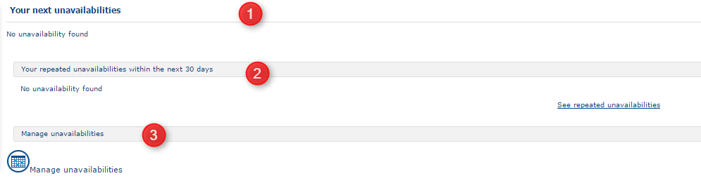

# Unavailabilities

## Overview

The **Unavailabilities** page lets you view, add, edit, or delete unavailabilities for a resource.

You can access the page from the **Portal** or **Planning** module, depending on the configuration. To open it, click **Unavailabilities** in the main menu.

An unavailability is a period during which a resource cannot perform an appointment. Unavailabilities are either one-off or regular:

* A [one-off unavailability](oneoffunavailabilities.md) applies to a specific period, such as a day of sick leave, time off in lieu, or a meeting.
* A [regular unavailability](regularunavailabilities.md) is repeated at regular intervals over a period of time.

Each unavailability is defined by a **type**, the **resource** concerned, a **date**, a **time window**, and a **location**. Some unavailability types have a default location configured for the resource. For example, the default location for a day of time off in lieu is the home address of the resource.


If an unavailability occurs while an appointment is planned for the same time window, the appointment is suspended.


## The Unavailabilities page

The page is divided into three sections:

1. The upper section lists the next one-off unavailabilities for the resource. See [One-off unavailabilities](oneoffunavailabilities.md).
2. The middle section lists the regular unavailabilities for the resource. See [Regular unavailabilities](regularunavailabilities.md).
3. The lower section manages unavailabilities. See [Adding an unavailability](addinganunavailability.md).

## In this chapter

* [One-off unavailabilities](oneoffunavailabilities.md)
* [Regular unavailabilities](regularunavailabilities.md)
* [Adding an unavailability](addinganunavailability.md)
* [Adding a multi-resource unavailability](addinganmultiresourceunavailability.md)
* [The unavailability form](unavailabilityform.md)
* [Unplanning or reassigning appointments](unplanningorreassigningappointments.md)
