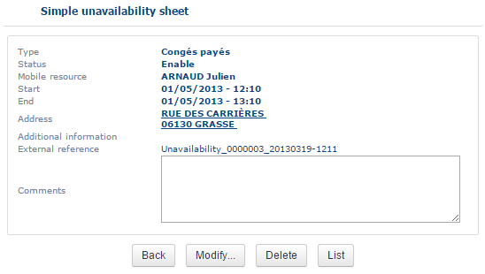

# The unavailability form

## Overview

The unavailability form shows the details of an unavailability.

## Open the form

* Click **Create a note** to open the unavailability form.

## Actions in the form

* Click **Delete** to delete a one-off unavailability.
* Click **Back** to return to the **Managing unavailabilities** page.
* Click **Modify** to change the dates of a regular unavailability.


You can modify a regular unavailability only if its period is in progress or has not yet begun.

