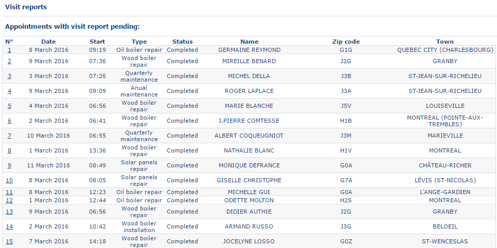
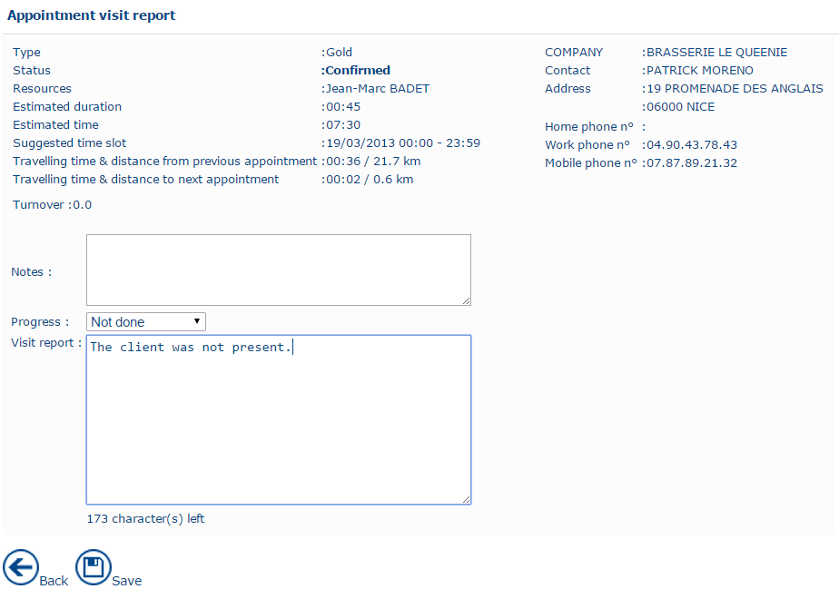

# Visit Reports

## Overview

A visit report tells the application whether an appointment has been completed, so you must create one for each appointment.

Creating a visit report involves two steps:

* **Update the appointment status** to one of the following:
  * **Unknown**
  * **Unfulfilled**
  * **Fulfilled**
  * **Unable to Fulfill**
* **Create the visit report** to record a brief summary of the appointment.

<!-- REVIEW: these status names (Unknown, Unfulfilled, Fulfilled, Unable to Fulfill) and the resulting statuses below differ from the names in "The different statuses for appointments in NFS" (for example Realized, Removed); kept as in the source -->

You can create a visit report only after the appointment has taken place. The **visit report date** must therefore be either before today's date or today's date.

The list of visit reports is displayed only when there are appointments that have already taken place but for which no visit report has been created and the appointment status has not been updated to **Unfulfilled** or **Fulfilled**.

## Create a visit report

1. In the list, find the visit report to create. Visit reports to be created are displayed in chronological order.
2. Click the number in the sequence to open the corresponding dialog box.

   

3. Review the appointment details and notes, set the appointment status and enter the visit report, as described in the following sections.
4. Click **Save** to save the changes.

Click **Back** to return to the previous screen without saving the changes. The list of visit reports awaiting completion is updated after you save a visit report.

## Fields and options

### Appointment details

The upper section of the dialog box displays key information about the appointment, including:

* **Appointment type**
* **Company**
* **Address**
* **Telephone numbers**
* **Appointment status**
* **Date**
* **Estimated time**
* **Proposed time slot**
* **Estimated duration**
* **Travel time**

### Notes

A series of notes provides additional information that can help the resource complete the appointment. You can also use this section to record any relevant comments or instructions.

### Appointment status

The **Status** list provides four options. After the appointment, the resource must select the appropriate status:

* **Status Unknown** – The resource has not completed the visit report. The appointment status remains unchanged.
* **Unfulfilled** – The appointment did not take place but was not cancelled. The appointment status changes to **Unplanned**.
* **Fulfilled** – The appointment was completed. The appointment status changes to **Fulfilled**.
* **Unable to Fulfill** – The appointment did not take place and will not be completed. The appointment status changes to **Cancelled**.

### Visit report

In the editable **Visit Report** section, the resource records information, notes and comments after the appointment. Use this section to document any actions taken or follow-up required after the appointment.
