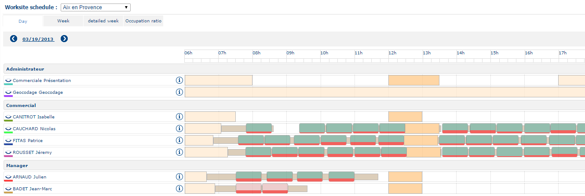
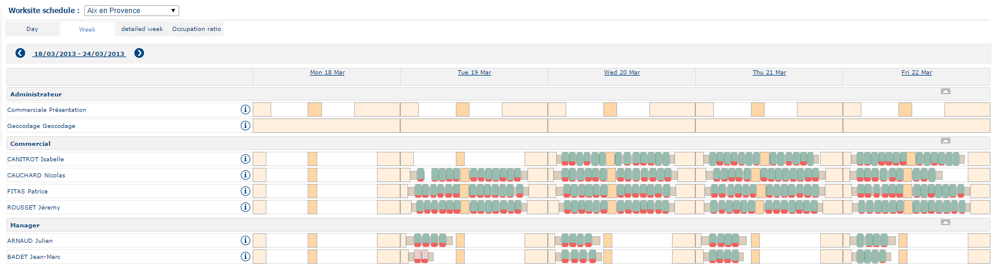
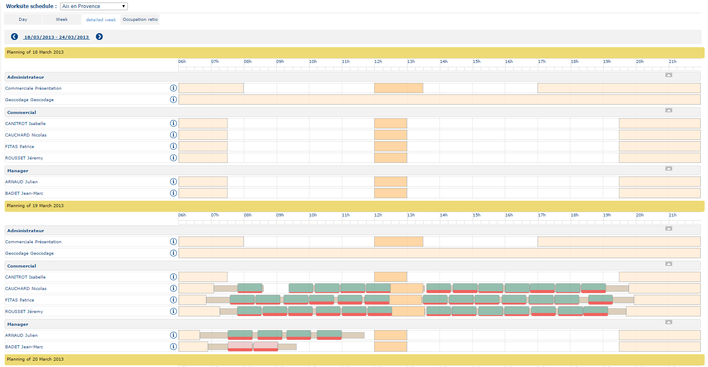
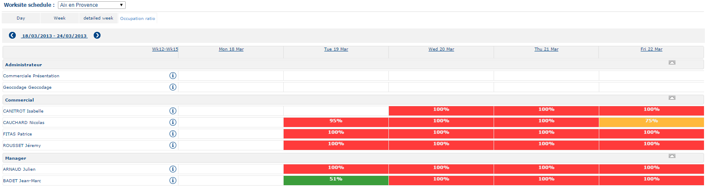
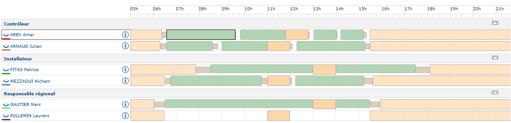

# Worksite Schedule

## Overview

This page shows the planning for one or more resources based on their assigned worksite. To open it, click **Worksite Schedule** in the main menu.

Depending on the configured rights profile, you can view your own planning, the planning for your assigned worksite, or the planning for all worksites.


A resource is always assigned to a main worksite. The resource can also be assigned one or more secondary worksites.



Depending on the user profile, the choice of worksite can be inactive. By default, NFS uses the worksite of the user.


## Navigate between periods and views

Click  to return to the previous day, or click  to go to the next day.

To view the week planner, click the **Week** tab.

Click  to return to the previous week, or click  to go to the next week.

To view the week planning day by day, click the **Detailed Week** tab.

Click  to return to the previous week, or click  to go to the following week.

To view the workload week planning (the cumulated time devoted to all appointments), click the **Occupation ratio** tab.

Click  to return to the previous week, or click  to go to the next week.

## Main and secondary worksites

Depending on the profile of the connected resource, there are three possible scenarios:

* Display the plannings for resources affiliated with the selected main worksite.
* Display the plannings for resources affiliated with a different main worksite but that have the selected worksite as their secondary worksite.
* Display the plannings for resources affiliated with a different main worksite but that have the selected worksite as their secondary worksite, and that have an appointment.

Resources and appointments can be framed:

* An appointment inside a frame indicates that the appointment is to be performed outside the main worksite.
* A resource inside a pink frame indicates that the resource is not affiliated with the main worksite (the one selected in the interface). However, this worksite is assigned to the resource as a secondary worksite where the resource can work.

In this example, the resource ARBY Amar is not affiliated with the main worksite of Narbonne. However, Narbonne is the secondary worksite of this resource. To distinguish this resource from the others, the name is framed in pink.

This resource has also fulfilled an appointment that is not linked to the Narbonne worksite. To indicate that the appointment was fulfilled outside the worksite, it is framed with a slightly thicker outline.

Finally, this resource has fulfilled an appointment linked to the Narbonne worksite, because this appointment is not framed.
