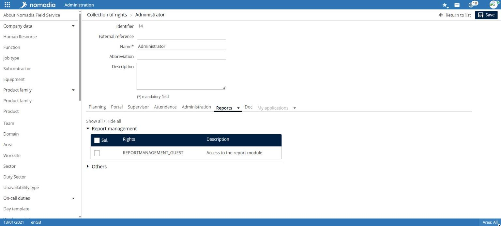
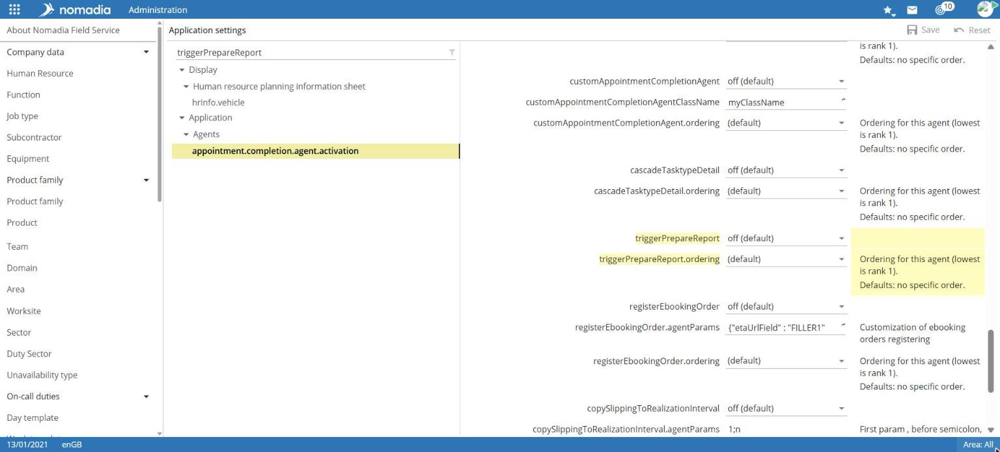
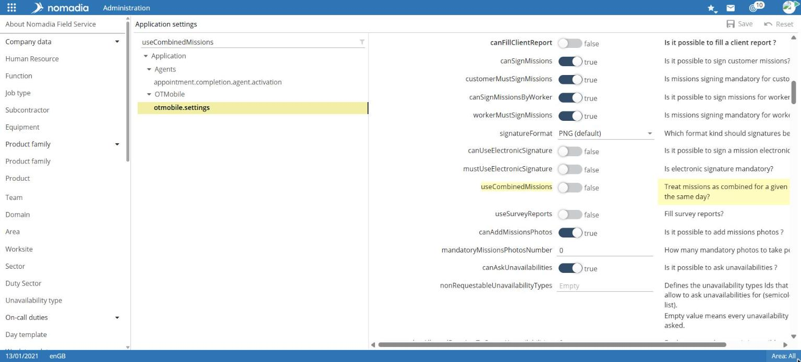
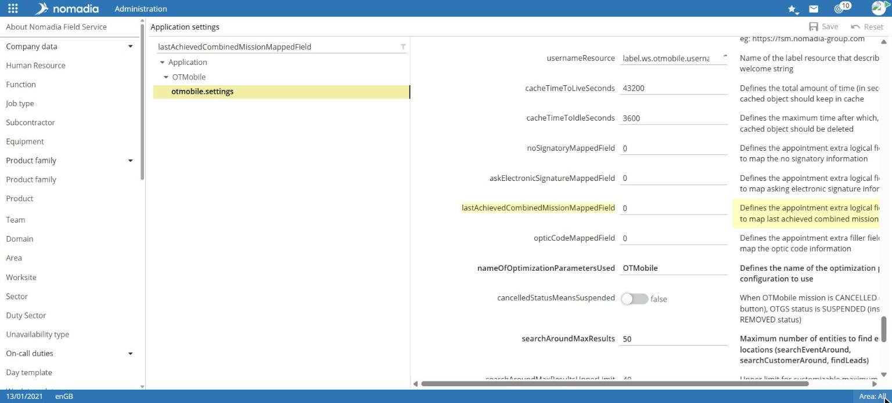

# Generate appointment reports

Nomadia Field Service can automatically produce an appointment report in PDF format. The report is built from a Word template containing fields linked to appointment data: customer, resource, products, form responses, photos, and signatures.

## General process

1. Prepare a Word report template with merge fields. See Prepare a report Word template.
2. Upload the template to the **Report** module.
3. Assign the required permissions to relevant profiles.
4. Enable automatic generation.
5. When an appointment changes to **Completed**, the PDF report is generated if no PDF report is already attached to the appointment.

## Before you start

* You need access to the **Report** module and **Administration**.
* Prepare your report template in Word format.

## Step 1: Assign permissions

**Navigation:** `Administration > Users > Permission collection`

1. Open the permission collection for the relevant profile.
2. Open the **Reports** tab from the **Modules** menu.
3. Select the required permissions:

| Permission                | Displayed description               |
| ------------------------- | ----------------------------------- |
| `REPORTMANAGEMENT_GUEST`  | Access to the report module         |
| `REPORTMANAGEMENT_CREATE` | Ability to create a report template |
| `REPORTMANAGEMENT_UPDATE` | Ability to update a report template |
| `REPORTMANAGEMENT_DELETE` | Ability to delete a report template |

4. For profiles that publish reports, open the **Scheduling** tab, then the **Appointments** section. Select `CALLCENTER_PUBLISH_REPORT` (**Allow report publication**).
5. Select **Save**.

## Step 2: Upload the report template

**Navigation:** `Report > Report template`

1. Select **New**.
2. In the **Template** tab, enter the template name in the **Name** field.
3. Select the folder icon (**Select a file**) and choose your Word file.
4. Select **Add** to upload the file.

* **Download** retrieves the template Word file.
* The trash icon (**Deselect a file**) removes the selected file.
* **Cancel** leaves the screen without creating the template.

### Edit a template

Edit the Word file, then upload the new version from the report template.

## Step 3: Enable automatic generation

**Navigation:** `Administration > Customization > Application configuration`

1. In the filter field at the top of the tree, enter `triggerPrepareReport`.
2. Select the **appointment.completion.agent.activation** node (**Application > Agents**).
3. For `triggerPrepareReport`, select **on**.
4. Select **Save**.


Application configuration applies to all users. Have your environment administrator approve this change.


## Result

When an appointment changes to **Completed**, a PDF report is generated from the template if no PDF report is already attached to the appointment.

## Make forms available in the mobile application

Forms created in **Report > Form template** let technicians enter answers during an appointment. These answers can then be included in the PDF report.

To make forms available in the mobile application:

1. In **Application configuration**, filter by `useSurveyReports`.
2. Enable `useSurveyReports` (**Fill survey reports?**).
3. Select **Save**.

The technician can then see forms available for their appointment in the mobile application's **Report** tab.

## Generate one report for combined missions

To combine several appointments in a single report:

1. In **Application configuration**, enable `useCombinedMissions` (**Treat missions as combined for a given … the same day?**).
2. Set `lastAchievedCombinedMissionMappedField` to a number from 1 to 15. This number identifies the appointment's additional logical field that identifies the last appointment.
3. Select **Save**.

The report is generated when the last appointment ends.
