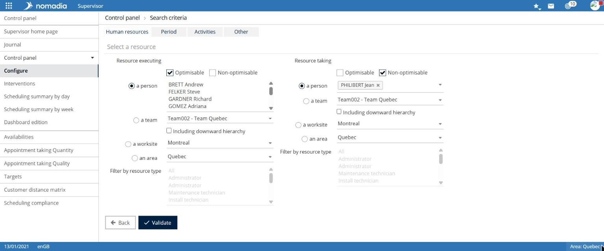
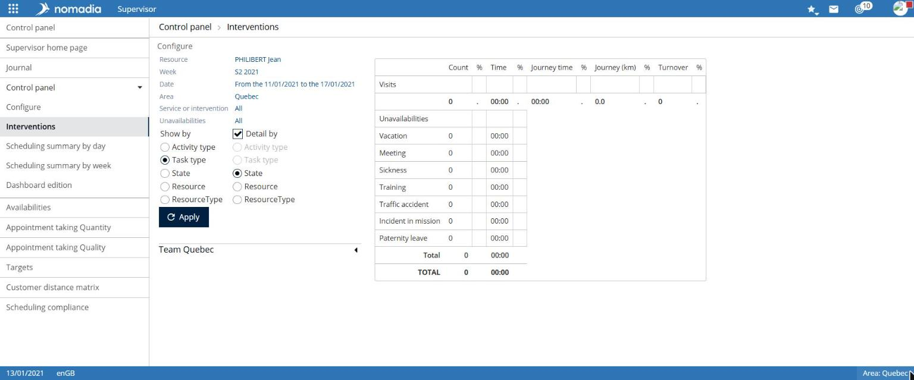

# Configure and view dashboards

Supervision dashboards present activity based on resource, period, and activity criteria.

## Configure criteria

**Navigation:** `Supervision > Dashboard > Configure`

The **Dashboard > Search criteria** page has four tabs.

| Tab                 | Criteria                                                                                                                                             |
| ------------------- | ---------------------------------------------------------------------------------------------------------------------------------------------------- |
| **Human resources** | **Performing resource** and **Entering resource**: a person, a team with **Entire hierarchy**, a work site, or a region; **Filter by resource type** |
| **Period**          | **Week**, **Month**, **Quarter**, **Year**, or **From** / **To** dates                                                                               |
| **Activities**      | Optional intervention type: **Ignore**, **Activity type**, or **Offer**, with **Status**; optional unavailability: **Type**                          |
| **Other**           | Display **Travel times** and **Idle times**                                                                                                          |

1. Enter criteria on each tab.
2. Select **Validate**.


The **Activities** and **Other** tabs state that their configuration is not used in schedule summary tables.


## View the Appointments table

**Navigation:** `Supervision > Dashboard > Appointments`

The page recalls the current configuration, including resource, week, dates, region, services, and unavailabilities. It displays one table per team.

1. In **Display by**, choose the grouping: **Activity type**, **Intervention type**, **Status**, **Resource**, or **Resource type**.
2. To add a second level, enable **Detail by** and choose the criterion.
3. Select **Apply**.

The table displays **Number**, **Time**, **Travel time**, **Travel distance (km)**, and **Revenue**, with their percentages, for appointments and each unavailability type.

## Other tables and analyses

| Entry                                                          | Available elements                                                                                                                    |
| -------------------------------------------------------------- | ------------------------------------------------------------------------------------------------------------------------------------- |
| **Schedule summary by day** / **by week**                      | **From** and **To** dates, **Show empty days** and **Show sums / indexes** options, **Search**, **Export csv**, **Configure** buttons |
| **Availabilities**                                             | Number of scheduled appointments, scheduled hours, and worked time per day and team                                                   |
| **Appointment scheduling quantity** / **quality**              | Scheduled appointments by number and percentage, with the configuration reminder: **Entered by**, resource, week, region              |
| **Objectives**                                                 | Configuration reminder: **Resource**, **Week**, **Service or intervention**                                                           |
| **Customer distance matrix** / **Customer centers of gravity** | **Mode**, **Required resources**, **Region resources**, **Display customer distances**, **Export csv**                                |
| **Overall unavailability schedule**                            | **Team**, **From**, **To**, **Export csv**                                                                                            |
| **Scheduling compliance** / **Overtime**                       | **From**, **To**, **Search**, **Export csv**                                                                                          |
| **Edit dashboard**                                             | Dashboard list and **New dashboard** button                                                                                           |
