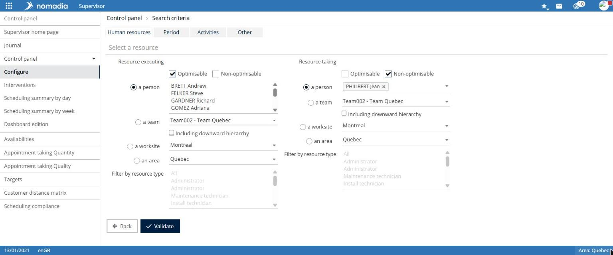
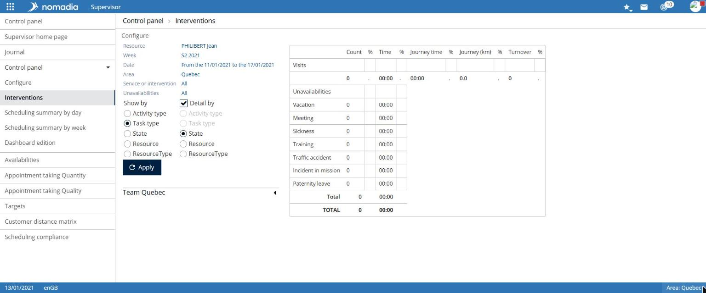

# Configure and view dashboards

Supervision dashboards present activity based on resource, period, and activity criteria.

## Configure criteria

**Navigation:** `Supervision > Dashboard > Configure`

The **Dashboard > Search criteria** page has four tabs.

| Tab                 | Criteria                                                                                                                                             |
| ------------------- | ---------------------------------------------------------------------------------------------------------------------------------------------------- |
| **Human resources** | **Performing resource** and **Entering resource**: a person, a team with **Entire hierarchy**, a work site, or a region; **Filter by resource type** |
| **Period**          | **Week**, **Month**, **Quarter**, **Year**, or **From** / **To** dates                                                                               |
| **Activities**      | Optional intervention type: **Ignore**, **Activity type**, or **Offer**, with **Status**; optional unavailability: **Type**                          |
| **Other**           | Display **Travel times** and **Idle times**                                                                                                          |

1. Enter criteria on each tab.
2. Select **Validate**.


The **Activities** and **Other** tabs state that their configuration is not used in schedule summary tables.


## View the Appointments table

**Navigation:** `Supervision > Dashboard > Appointments`

The page recalls the current configuration, including resource, week, dates, region, services, and unavailabilities. It displays one table per team.

1. In **Display by**, choose the grouping: **Activity type**, **Intervention type**, **Status**, **Resource**, or **Resource type**.
2. To add a second level, enable **Detail by** and choose the criterion.
3. Select **Apply**.

The table displays **Number**, **Time**, **Travel time**, **Travel distance (km)**, and **Revenue**, with their percentages, for appointments and each unavailability type.

## Other tables and analyses

| Entry                                                          | Available elements                                                                                                                    |
| -------------------------------------------------------------- | ------------------------------------------------------------------------------------------------------------------------------------- |
| **Schedule summary by day** / **by week**                      | **From** and **To** dates, **Show empty days** and **Show sums / indexes** options, **Search**, **Export csv**, **Configure** buttons |
| **Availabilities**                                             | Number of scheduled appointments, scheduled hours, and worked time per day and team                                                   |
| **Appointment scheduling quantity** / **quality**              | Scheduled appointments by number and percentage, with the configuration reminder: **Entered by**, resource, week, region              |
| **Objectives**                                                 | Configuration reminder: **Resource**, **Week**, **Service or intervention**                                                           |
| **Customer distance matrix** / **Customer centers of gravity** | **Mode**, **Required resources**, **Region resources**, **Display customer distances**, **Export csv**                                |
| **Overall unavailability schedule**                            | **Team**, **From**, **To**, **Export csv**                                                                                            |
| **Scheduling compliance** / **Overtime**                       | **From**, **To**, **Search**, **Export csv**                                                                                          |
| **Edit dashboard**                                             | Dashboard list and **New dashboard** button                                                                                           |

## View the schedule summary

The **Schedule summary by day** and **Schedule summary by week** pages present, for each field worker in the configuration, the indicators of their routes: visits, trips, unavailabilities, leave, working time, and breaks.

1. Open **Schedule summary by day** (or **by week**).
2. Enter the **From** … **to** period.
3. If needed, select **Show empty days** to also list days without activity.
4. If needed, select **Show sums & indexes** to add a totals row and indexes, for example the kilometers traveled per visit or the share of working time spent on visits.
5. Select **Search**, then **Export csv** to export the table.

## Read the Appointment taking tables

These tables require prior configuration: without it, an error message appears. For more information, see [Configure criteria](#configure-criteria).

* **Appointment taking Quantity** measures the volume of appointments taken by the selected resource, compared with that of the work site and the region. For appointments placed by optimization, it compares the actual cost of the appointments with the best cost proposed: an average of actual costs close to the average of optimal costs indicates that appointments are taken at the best cost.
* **Appointment taking Quality** measures the number of appointments taken, cancelled, and modified, and the lead times offered to the customer, for example the average time between taking the appointment and the visit.

## Track objectives

The **Targets** table compares the activity of the configured period with the objectives defined in Administration. For more information, see [Manage objectives, activity monitoring, and typologies](../administration/manage-objectives-activity-monitoring-and-typologies.md).

If no objective matches the configuration, the message "No objective found" appears.

For the analyses (distances, centers of gravity, compliance, overtime), see [Use the Supervision analyses](use-supervision-analyses.md).

<!-- REVIEW: the schedule summary, Appointment taking, and Targets sections are translated from the updated French topic. The page titles Schedule summary by day and Appointment taking Quantity / Quality match the Supervisor menu of the test environment (where the objectives entry is named Targets). The Show empty days and Show sums & indexes labels and the "No objective found" message were not verified. The French topic has no screenshot of the schedule summary yet. -->
