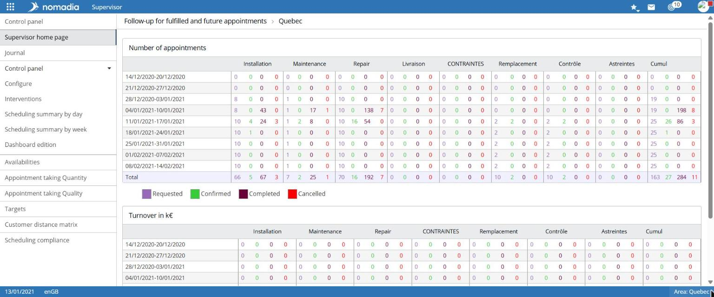

# Track past and upcoming appointments

The **Supervisor home** page presents the number of appointments and related revenue, week by week.

## Access the feature

**Navigation:** `Supervision > Supervisor home`

## Read the page

The **Track past and upcoming appointments** page is followed by the region name. It contains two tables:

* **Number of appointments**: for each week, the number of **Candidates**, **Scheduled**, **Completed**, and **Cancelled** appointments, by group or intervention type;
* **Revenue in k€**: for each week, **Requested**, **Confirmed**, **Completed**, and **Cancelled** amounts.

The **Cumulative** column totals the values in each row. The **Total** row totals the weeks.

Each number colour corresponds to a category shown in the legend below the table.
