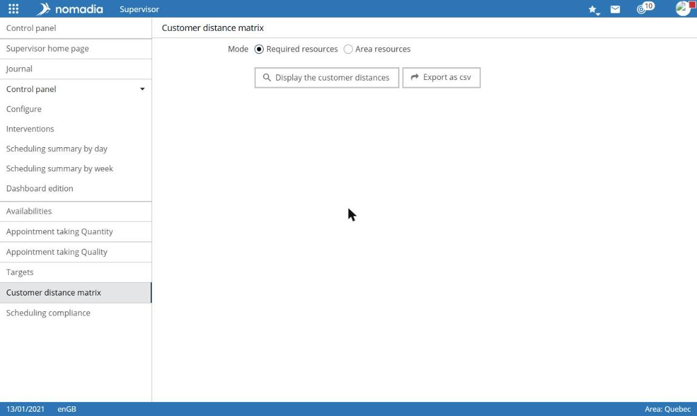

# Use the Supervision analyses

The Supervision analyses produce exportable tables to study how routes are organized: distances between field workers and customers, geographic distribution, unavailabilities, schedule compliance, and overtime.

## Access the feature

**Navigation:** `Supervision > module menu`, analyses section

The entries displayed depend on your rights. Each analysis offers an export button to produce a CSV file.

## Measure distances between field workers and customers

The **Customer distance matrix** analysis displays, for each field worker, the distance (in km) and the travel time (in minutes) to each customer.

1. Open **Customer distance matrix**.
2. In **Mode**, choose **Required resources** or **Area resources**.
3. Select **Display the customer distances**.
4. Select **Export as csv** to export the table.

## Locate the customers' centers of gravity

The **Customer center of gravity matrix** analysis displays, for each field worker, the center of gravity of the customers attached to the field worker, and the distance to that center. It helps you check that a field worker is well placed in relation to their customers.

1. Open **Customer center of gravity matrix**.
2. Choose the **Mode**: **Required resources** or **Area resources**.
3. Start the search, then export if needed.

## View the global unavailabilities planning

The **Unavailabilities global planning** analysis displays the unavailabilities of the field workers in a team.

1. Open **Unavailabilities global planning**.
2. Choose the **Team** and the period (**from** … **to**).
3. Select the export button.

## Track schedule compliance

The **Scheduling compliance** analysis tracks, by work site and by day, the share of appointments completed on the planned date.

1. Open **Scheduling compliance**.
2. Enter the period (**From the** … **to the**), then select **Search**.
3. Select **Export as csv** to export the result.

## Calculate overtime

The **Overtime** analysis compares, for each field worker and each day, the limits of the working day with the hours actually worked.

1. Open **Overtime**.
2. Enter the period (**from** … **to**), then select the search button.
3. Select the export button to export the result.


The calculation relies on the field workers' start-of-day and end-of-day markers, declared in particular from the mobile application. Without these markers, no hours are calculated.


<!-- REVIEW: the Customer distance matrix and Scheduling compliance pages were verified in the application. The test environment's Supervisor menu has no customer center of gravity, unavailabilities global planning, or overtime analyses, so those three sections (their names, options, and buttons) are translated from the French topic and were not verified. The module is named Supervisor in the test environment's application launcher. -->

