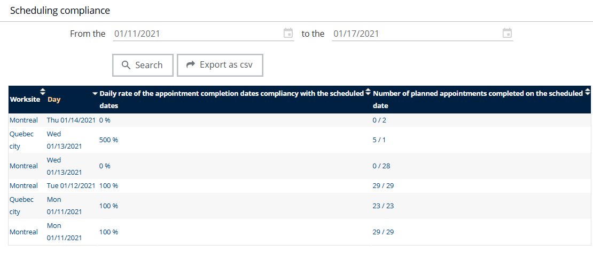

# Analyses - Scheduling Compliance

## Overview

Use this analysis to track the number of appointments completed by the expected date. It shows the degree of conformity with the established planned schedules (compliance).

## Display and export the table

1. Define the search period in the fields at the top of the page.
2. Click the  button to display the table.
3. Click the  button to export the result in `.csv` format.
