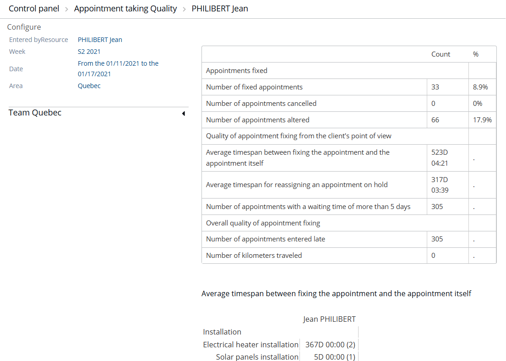

# Control Panel - Appointment taking Quality

## Overview

This page provides a summary table of statistical information on appointments in terms of quality.

## Prerequisites

Configure the control panel first. See [Control Panel - Configure](controlpanelconfigure.md).

## Sections of the table

The table is divided into five sections.

1. **Configure** – click it to return to the previous configuration step. See [Control Panel - Configure](controlpanelconfigure.md).
2. Information about the resource for which the table is calculated, the period during which the dates are displayed, and the area.
3. The table in the right-hand part of the screen, which provides three types of information (themes). See below.
4. The hierarchical tree, which shows all the resources of the reference area, organized by team. Click an entity to update the corresponding table (3). Expand or collapse the tree as required.
5. The average time spans between the taking of the appointment and the visit, for each type of intervention. The turnover in brackets corresponds to the number of appointments fulfilled.

## Fields and options

### Appointment theme (3)

This theme provides three indicators:

* **Number of appointments taken** – the manually made and optimized appointments taken by the chosen resource. This value is the total, and so represents 100%.
* **Number of appointments cancelled** – the manual and optimized appointments that have been invalidated. The number is displayed with a percentage.
* **Number of appointments modified** – the manually taken and optimized appointments for which one component has been modified (date, time, resource, intervention type). The number displayed is completed by a percentage.

### Quality theme (3)

This theme offered to the customer calculates at least five indicators. They are all expressed in a number of days, as the infobox confirms.

* **Average time span between the making of an appointment and the visit** – the time calculated between the date and time of the taking of the appointment and those of its completion.
* **Average time delay when reassigning a suspended appointment** – the time calculated between the date and time of the suspension of an appointment and its reassignment.
* **Number of appointments for which the waiting time is more than 5 days** between the taking of the appointment and the visit.
* **Average delay Sector N** – this indicator is repeated for each of the sectors in the selected area. It is the average time span between the taking of the appointment and the visit, for all appointments in the reference sector of the visiting resource.
* **Average out of sector time span** – for an area that has several sectors and contains a geographic space that falls "outside the sector", the average time span between the taking of the appointment and the visit by the resource responsible for fulfilling the appointment.

### General Quality theme (3)

This theme calculates two indicators:

* **Number of visit reports entered late** – the Field Consultant resource has a time span of n days (configurable) to produce the visit report after the visit is completed. This number takes into account the completed appointment and the configured time span within the configured period.
* **Number of kilometers traveled** – the sum of all the kilometers traveled for all the appointments fulfilled, modified or suspended during the configured period for which the mobile resource has been assigned (only the field consultants working for the configured resource).
