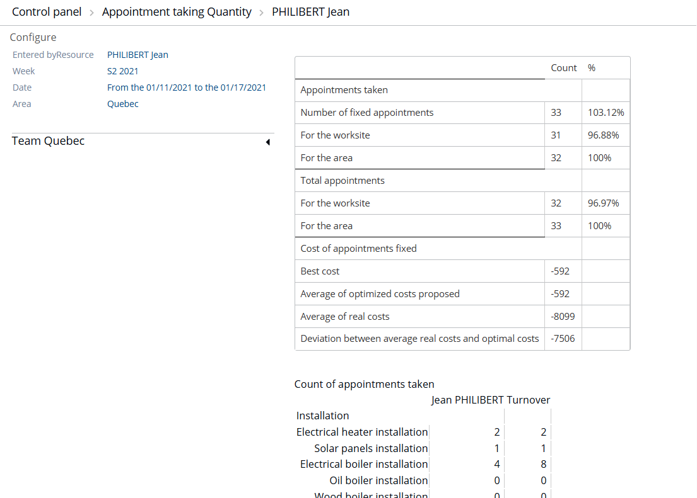

# Control Panel - Appointment taking Quantity

## Overview

This page provides a summary table of statistical information on appointments in terms of quantity.

## Prerequisites

Configure the control panel first. See [Control Panel - Configure](controlpanelconfigure.md).

## Sections of the table

The table is divided into five sections.

1. **Configure** – click it to return to the previous configuration step. See [Control Panel - Configure](controlpanelconfigure.md).
2. Information about the resource for which the table is calculated, the period or date, and the area.
3. The table in the right-hand part of the screen, which provides information about appointments and their quality (cost of appointments taken). See below.
4. The hierarchical tree, which shows all the resources of the reference area, organized by team. Click an entity to update the corresponding table (3). Expand or collapse the tree as required.
5. A table that summarizes the number of appointments made and the turnover generated by intervention type.

## Fields and options

### Quantity indicators (3)

* **Number of appointments taken** – the manually made and optimized appointments made by the chosen resource. The number displayed is completed by a percentage.
* **Total number of appointments on the site** – the manually made and optimized appointments taken by all resources on the site.
* **Total number of appointments for the area** – the sum of the two preceding values: the appointments taken by the connected resource and those taken for the whole site.

The last value is 100%. The first two values are expressed as a percentage of it.

### Quality indicators (3)

Four indicators are calculated concerning costs. This information applies only to optimized appointments, not to those taken manually. Each time an appointment is taken, a cost is calculated as a function of the different constraints (time, unavailabilities). An appointment therefore has a real cost and a best cost.

* **Best cost** – the value, for any calculated appointment, that optimizes the constraints. This value must tend toward the lowest possible value.
* **Average of optimum costs suggested** – the total of the best costs for the appointments suggested while taking appointments for the configured period and resource, divided by the total number of appointments.
* **Average of real costs** – the sum of the costs calculated for each appointment taken for the configured period and resource, divided by the total number of appointments. When the last two values are close, the resource taking the appointments gives as much weight as possible to making appointments at the best possible cost.
* **Gap between the average of real and optimum costs** – the difference between the average of optimum costs suggested and the average of real costs.
