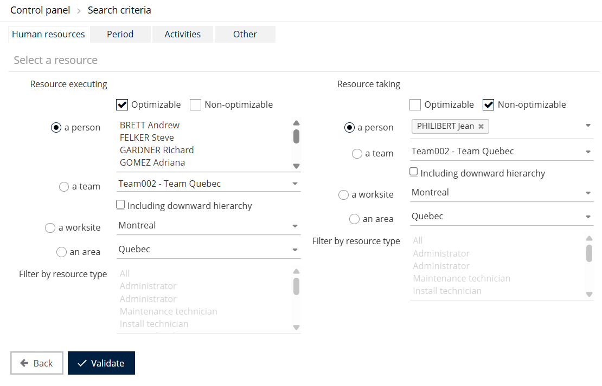
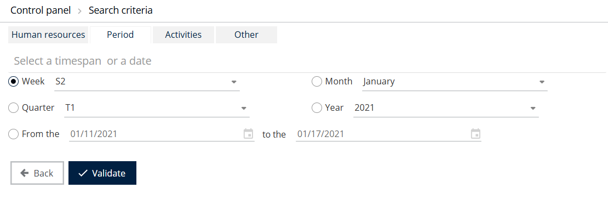
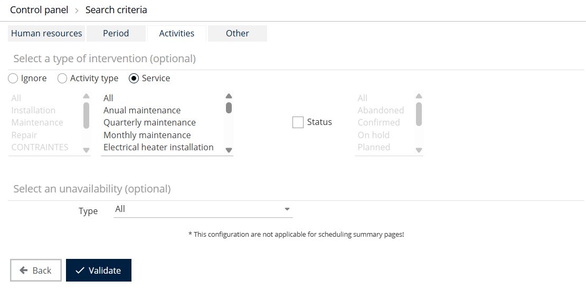
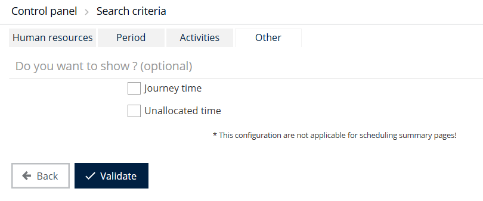

# Control Panel - Configure

## Overview

Configuring the control panel is essential to fine-tune the calculations that the control panel performs. You set parameters for the different families of search criteria.

## Fields and options

### Human resources

Configure two resources:

* The executive resource, that is, the mobile resource.
* The resource responsible for entering data in the system, that is, the person who saves the appointment in the application.

For each of these, you can select one of several types of resource:

* **Optimizable** or **non-optimizable**
* **A person**: the drop-down list shows all the connected supervisor resources. Select one of them.
* **A team**: the list shows the teams in the supervisor's area. Select the team for which you want statistics.
* **A worksite**: several worksites can exist in the reference area. The list lets you filter on the worksite for which you want information.
* **An area**

You can filter the search results by type of resource. The type of resource corresponds to the type of post assigned to each resource.

### Period

After you select the resources for which you want information, five options let you filter on the type of time span.

* **Date**: first select the year, then adjust as appropriate:
  * **Week**: each numbered week of the year is offered.
  * **Month**: the twelve months of the year are offered.
  * **Quarter**: the four numbered quarters of the year are offered.
  * **Year**: the years 2000 to 2030 are available.
* **Period** (From the... to the...): two fields open a calendar so you can choose a custom period.


By default, the values suggested are those that correspond to today's date.


### Activities | Intervention type (optional)

* Select the **Ignore** check box to disable the selection of an intervention type.
* Select the **Activity type** check box to choose one or more activity types. Each activity type can include several intervention types. To select several activity types, hold **Ctrl** or **Shift** while you select.
* The **Status** option is optional. Select the check box to filter interventions by status. You can select **Cancelled**, **Confirmed**, **Completed**, **Requested but unplanned** or **Unplanned**.
* Select **Display all** to display the status of all information items based on the selected intervention type.

### Activities | Unavailability (optional)

A drop-down list shows the different types of unavailability. You can select all of them.

Clear the **Type** check box to disable the selection of an unavailability type.

### Other

Two options can complete the control panel: calculation of journey time and calculation of free time.

## Apply the configuration

1. Click **Validate** to apply the selected parameters.
2. Select a type of statistical table to which to apply the configuration.
