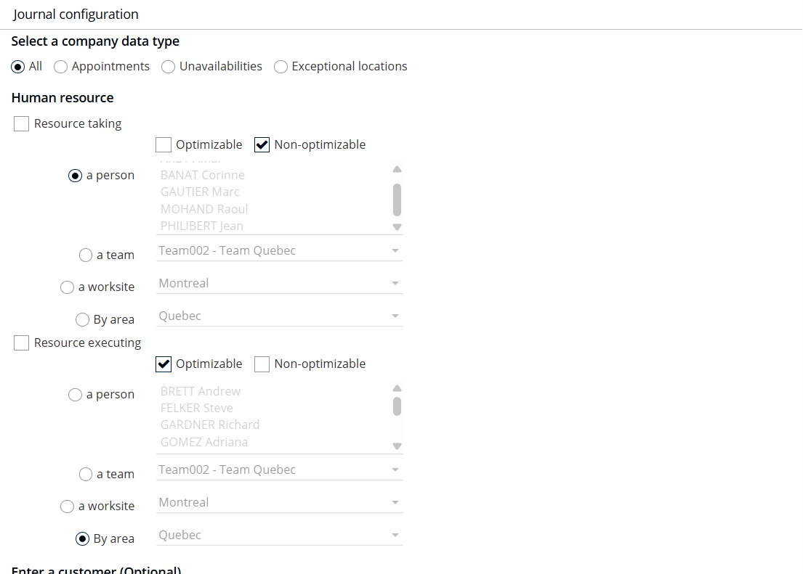
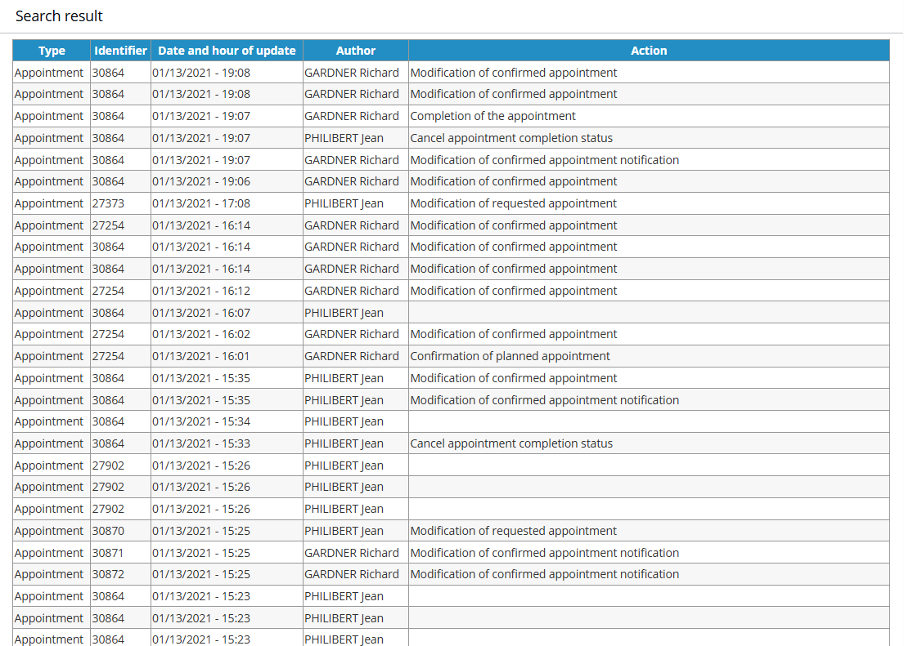
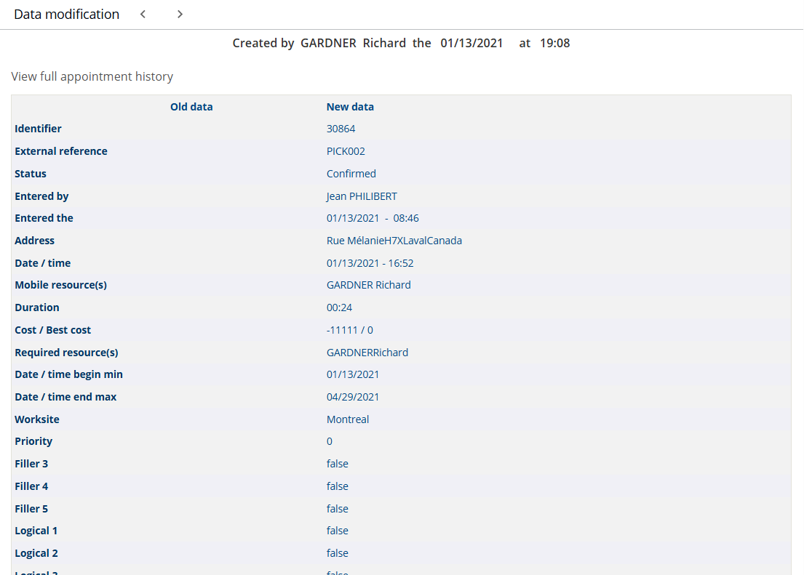
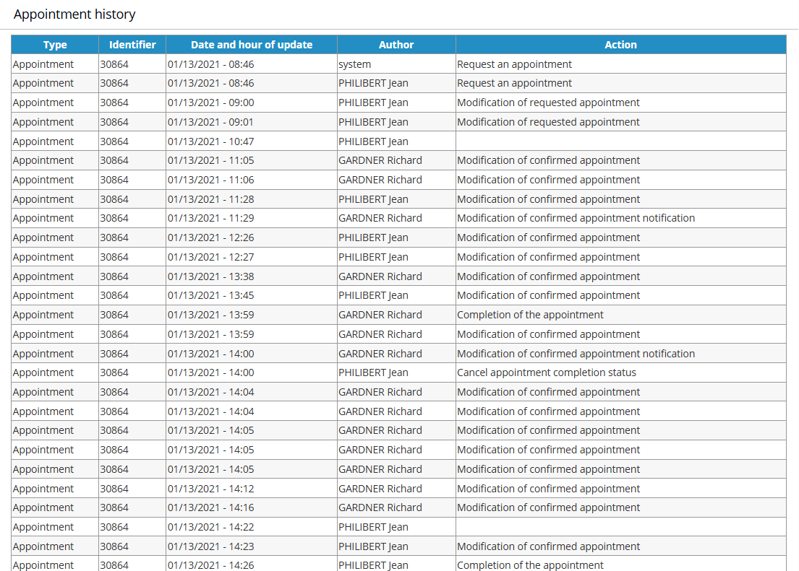

# Journal

## Overview

Depending on the rights granted to you (see [User Handling](../administration/userhandling.md)), the journal lets you consult the history of actions taken on human resources, appointments, unavailabilities, customers, on-call duties, jobs, worked days and agenda markers.

An entry in the journal corresponds to an **action** performed by a user (**taking resource**) on an **object** (human resource, appointment, unavailability, customer, on-call duty, job, worked day or agenda marker) that is assigned, as required, to an **executive resource**.

You work in two steps:

1. A first filter page lets you target the data to display by action, taking resource, object characteristics, customer and executive resource.
2. The list of filtered entries then displays, so that you can view the modifications made to a given object.

## Filter the journal

Click **Journal** in the Supervisor module menu to open the journal home page.

The filters are divided into five sections.

### Choice of company data type

This is the type of action performed by an NFS user that resulted in changes to an appointment, an unavailability and so on, or in changes applied to all these object types.

For appointments, the following values are available:

* **All** – displays all actions.
* **Appointment planned** – the action of confirming an appointment (manual or automated).
* **Appointment unplanned** – the action of unplanning an appointment (manual or automated).
* **Appointment unplanned by an appointment** – an appointment that has been reactivated or suspended following the registration of another appointment.
* **Appointment unplanned by an unavailability** – an appointment that has been reactivated or suspended following the registration of an unavailability.
* **Appointment accepted**
* **Reservation of planned appointment**
* **Confirmation of planned appointment**
* **Appointment withdrawn**
* **Appointment cancellation** – the action of cancelling an appointment (manual or by batch).
* **Appointment cancelled by the client** – the action of cancelling an appointment by the customer.
* **Appointment cancelled by the company** – the action of cancelling an appointment by the NFS user.
* **Appointment ignored**
* **Appointment completed as planned**
* **Appointment completed out of planning**
* **Unplanned appointment completion**

For other objects (unavailabilities, restrictions, constraints and so on), the following values are available:

* **All** – displays all actions.
* **Object creation** – the action of creating an object.
* **Object deletion** – the action of deleting an object.

### Human resource

Select the corresponding check boxes to filter on the **taking resources** (NFS users) and on the **executive resources** (workers or technicians).


All actions can be linked to one user (planning, modification and so on), but not all actions relate to a resource. An example is the modification of a requested appointment where no resource is requested.


For a resource (taking or executing), several filters are available:

* **Mobile** or **Non-mobile** – filters the resources defined as mobile or non-mobile in the resource form. See [Company Data](../administration/companydata.md).
* **A person** – designates the person or persons concerned (executing or taking). To select several, hold **Ctrl** or **Shift**.
* **A team** – selects all resources that belong to a given team.
* **A worksite** – selects all resources that belong to a given worksite.
* **By area** – selects all resources that belong to a given area.


For the selection by area, team or person to work, the resources must be associated with a team. See [Company Data](../administration/companydata.md).


### Enter a customer

* **Name of the customer** – the business name as registered on the customer form.
* **Contact name** – the name of the main contact for this customer.
* **Reference** – the customer's external reference. See [Glossary](../glossary/glossary.md).

### Enter an identifier

* **External** – the external reference of the modified object. See [Glossary](../glossary/glossary.md).
* **Internal** – the internal reference of the modified object.

### Choice of the period

Click the calendars to choose the dates.

* **From the** – the earliest date of the search period.
* **To the** – the latest date of the search period.
* **Limit the display to the X last actions** – displays only the last X results returned.

### Validation

Click **Validate** to calculate and display a table that corresponds to the configured criteria.

## Search result

The results are displayed in reverse chronological order.

The following fields are displayed:

* **Type** – the type of object concerned.
* **Identifier** – the internal identifier of the object.
* **Date and time of the modification** – the date and time of the action that led to the modification of the object.
* **Author** – the user responsible for the modification.
* **Action** – the action that led to the modification (for example, an appointment request).

## View the details of an action

1.  Click a line of the search result to open the associated information.

    

    The table displays the data associated with the event under the heading "New data". The old values are displayed only when the status of an event changes, such as when a planned appointment is fulfilled or an unavailability is cancelled. The table also shows the user who modified the event and the **date and time** of the modification.
2.  Click **See full appointment history** to view the complete history and lifecycle of the appointment.

    
3. Click the  button to return to the previous step, that is, the journal calculated from the selected parameters.
