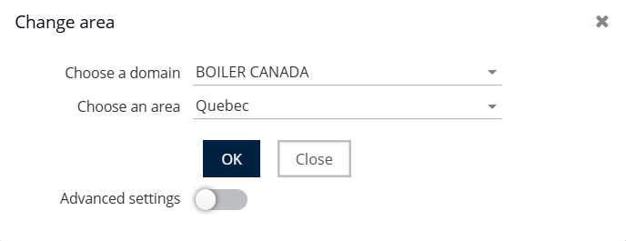
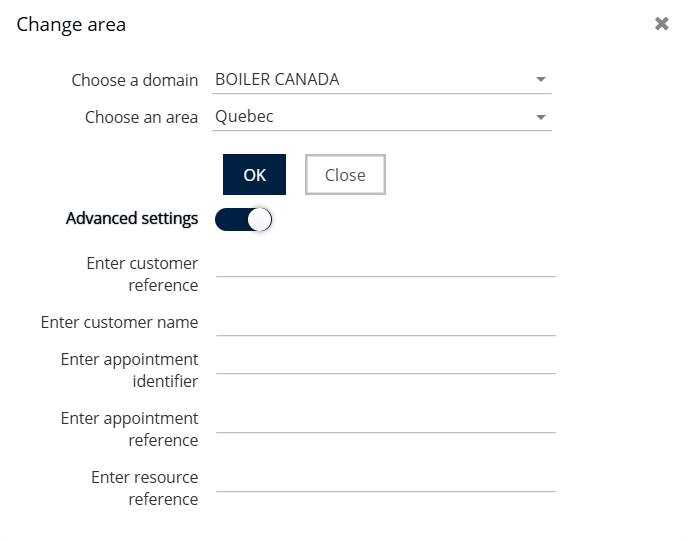

# Change the Area

## Change the current area

1.  In the **header bar**, click the name of the current area.

    
2.  In the **Choose an area** drop-down list, select the required area.

    You can also use the list to filter and quickly find an area.

    

## Change the area to find an appointment outside the current area

1. Select the **Advanced settings** check box.
2. Search for the required area using a reference or customer name, appointment, or resource reference.
3.  Select the relevant result to change the current area.

    
4. Click **Validate** to display the chosen area.
