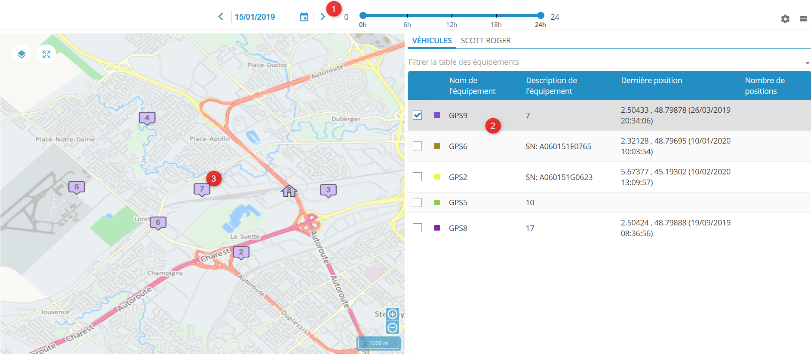
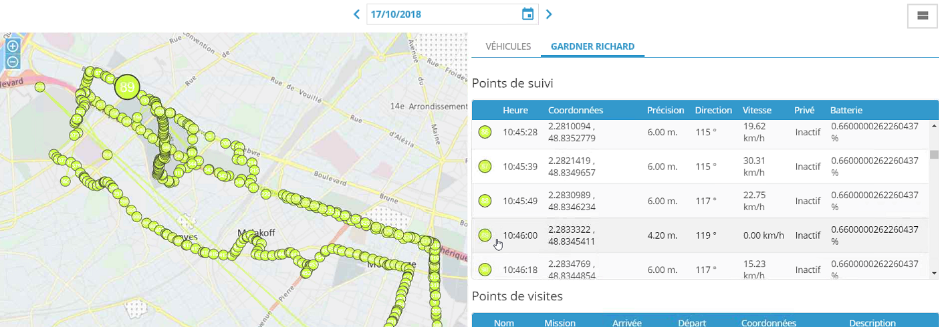

# Tracking

## Overview

The Tracking module lets you display, in real time, the GPS positions of [mobile resources](administration/companydata.md) that are assigned a [vehicle](administration/mobility.md) and a [tracking device](administration/mobility.md). The positions shown depend on your region of affiliation. You can also filter by [worksite](administration/companydata.md) using the **Filter device table** link.

## Prerequisites

You can access the Tracking module only if the [corresponding right](administration/userhandling.md) (**Tracking** tab > **Perimeter** > `TRACKFLEET_GUEST` right) is associated with your user profile.

## Track a resource

1. Select a day and the period.
2. In the **Vehicles** tab, select the resource (resource, vehicle or device) that you want to track.
3. The map updates automatically with the visit points and the plot of any tracking points for the resource. Move the mouse over these points to display an infobox.

   A second tab under the selected resource name also appears. It provides details of all the relevant waypoints (visit and tracking).


You can display the items on this page horizontally or vertically (`images/ref/buttons/bouton-tracking-pos.png`). You can also customize the display with the **Settings** button (`images/ref/buttons/bouton-tracking-param.png`), for example to filter the display of position markers or to customize table fields.


<!-- REVIEW: the two button icons (bouton-tracking-pos.png, bouton-tracking-param.png) are only text paths in the source and no matching image exists in .gitbook/assets -->
