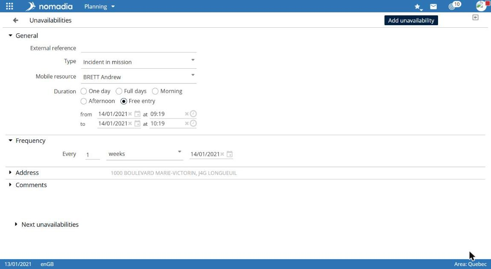
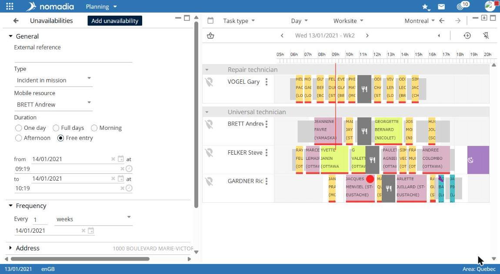

# Create an unavailability

Use this procedure to declare a one-time or recurring unavailability for a resource.

## Access the feature

**Navigation:** `Planning > Planning menu > Manage unavailabilities`

The **Unavailability management** panel appears on the left. The schedule on the right displays the selected resource on the entered date.

## Use the feature

1. In the **General** section, select the unavailability **Type**.
2. Select the **Resource**.
3. Choose the **Duration**: **One day**, **Full days**, **Morning**, **Afternoon**, or **Flexible schedule**.
4. Enter the **From** and **To** dates and times.
5. If the unavailability repeats, open the **Recurrence** section. Enter **Every** with a number and unit: **days**, **weeks**, or **months**, then enter an end date.
6. Enter an **Address** and **Comments** if needed.
7. Select **Add unavailability**.

## Result

The unavailability appears in the resource schedule and in the list below it, with its start and end times and type.

## Handle a conflict with appointments

If the unavailability overlaps appointments, a screen lists the appointments concerned. A warning flags the confirmed or booked appointments. Depending on your rights and the configuration, you can:

* go back to the entry to change the unavailability;
* select **Force**: create the unavailability and remove the conflicting appointments from the schedule;
* select **Force/Manage**: create the unavailability, remove the conflicting appointments, then try to reschedule them automatically. A screen then shows the reassigned and unassigned appointments: select the new assignments to confirm, then select **Continue**.


Appointments removed from the schedule become candidates again. By default, a planned appointment returns to the **Requested** status, and a confirmed or booked appointment to the **Suspended** status. This behavior depends on the configuration.


If the unavailability overlaps another unavailability of the same resource, it is not created: change the dates or the resource.

## Notes

* The **Upcoming unavailabilities** list at the bottom of the panel shows future unavailabilities.
* The **Address** section provides **Validate address**, **Position**, **Map**, and **Hotel** buttons.
* If the **Invalid recurring unavailability declaration** message appears, check the dates, times, and **Recurrence** section. Also check unavailabilities already declared for that resource during the period.

<!-- REVIEW: the conflict screen (Force, Force/Manage, Continue) is translated from the updated French topic and was not verified in the application, because creating a conflicting unavailability would change data in the test environment. The French topic itself has no screenshot of this screen yet. -->
