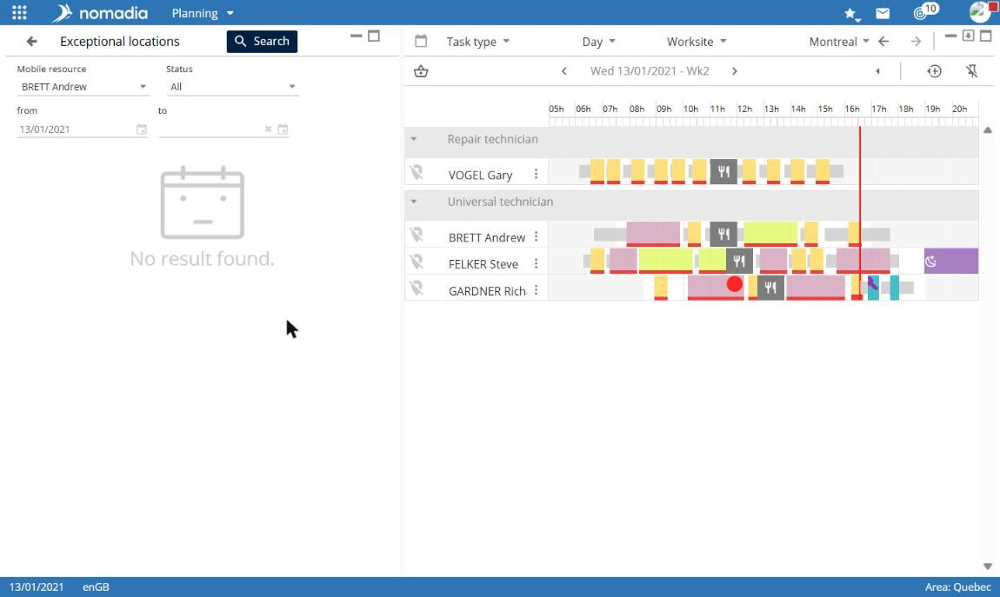

# Manage exceptional locations

An exceptional location is a temporary start or end location for a field worker's route. It is mainly used to manage overnight stays, but also an unusual departure or return, or an unusual start or end of day time. An address is required.

## Access the feature

**Navigation:** `Planning > Planning menu > Exceptional locations`

## Search for exceptional locations

1. Filter by **Mobile resource**, **Status** (**All**, **Confirmed**, or **To be confirmed**), and period (**from**, **to**).
2. Select **Search**.

## Create an exceptional location

1. Select **New**.
2. Choose the field worker.
3. Enter the address and validate it. For an overnight stay, you can choose a hotel recorded in **Hotel locations**. For more information, see [Manage other planning items](../planning/manage-other-planning-items.md).
4. Enter the period: start date and time of day, end date and time of day.
5. If needed, enter an unusual start or end of day time.
6. Create the location with the **Confirmed** or **To be confirmed** status.

With the corresponding right, **Suggest exceptional locations** calculates proposals for exceptional locations.

## Points to note


An exceptional location that is **To be confirmed** can be changed by optimization. A **Confirmed** location is no longer challenged.


* Exceptional locations are displayed in the field workers' schedule. See the legend for their color (**Exceptional location** and **Confirmed exceptional location**).
* To configure the types of exceptional location, see [Configure unavailability and exceptional location types](../administration/configure-unavailability-and-exceptional-location-types.md).

<!-- REVIEW: the New button is not displayed for the test profile. The Confirmed and To be confirmed status values, the Suggest exceptional locations button, and the legend labels are translated from the French topic and were not verified in the application. -->
